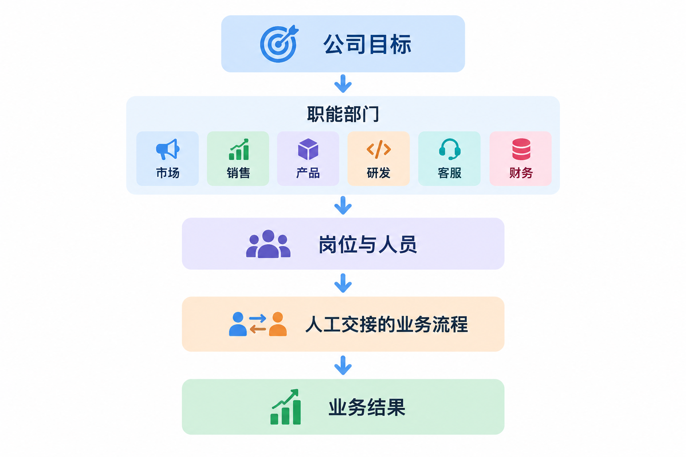
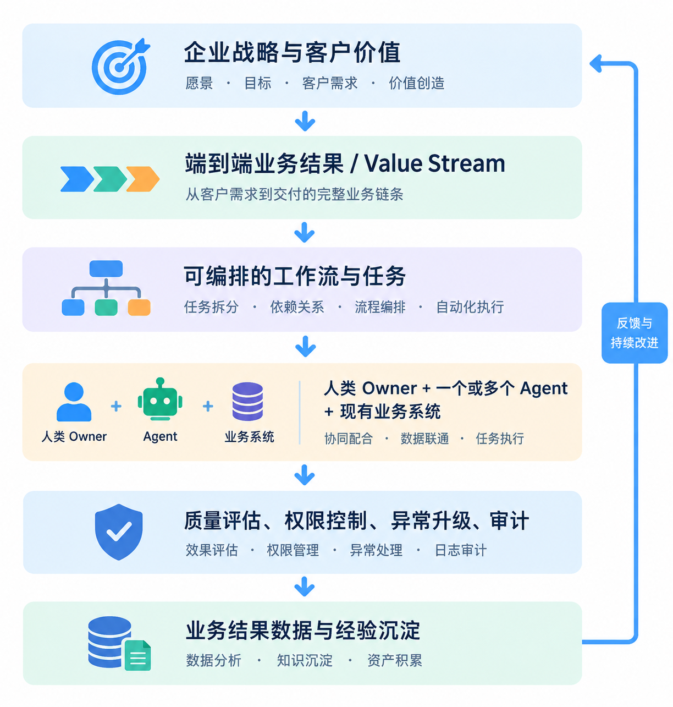
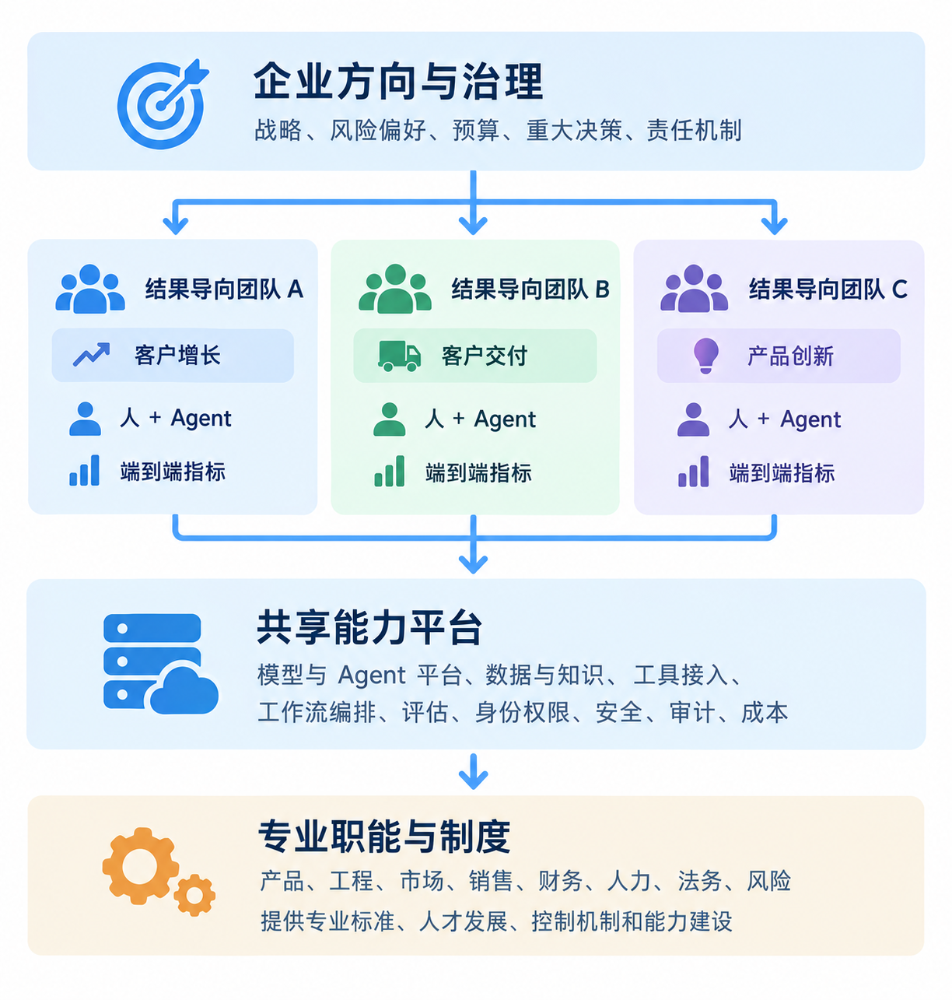
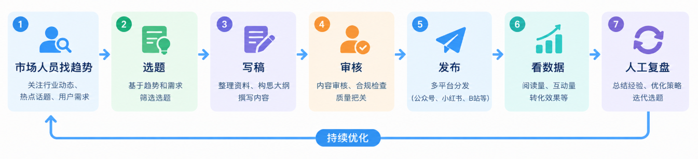
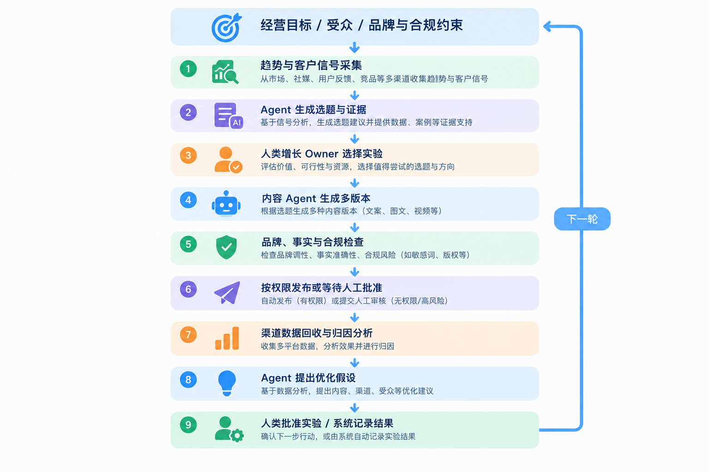
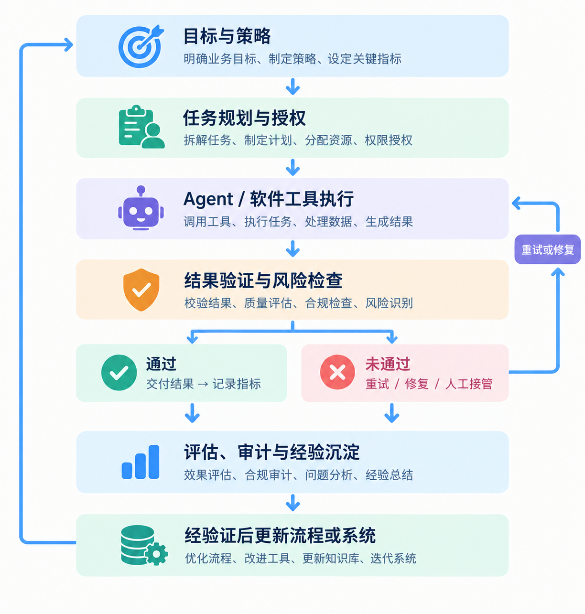

**AI Native 组织到底应该围绕什么来组织？人、Agent，还是业务结果？**

## 前言：AI 已经不只是效率工具，组织设计才是下一道题

过去几年，企业引入大语言模型（LLM），往往从个人工具开始：员工用 AI 写文案、总结会议、生成代码、分析数据。接下来，企业把 AI 接入客服、销售、研发、财务和运营流程，开始部署能够调用工具、执行多步骤任务的 Agent。

但截至 2026 年，企业面临的关键问题已经不只是“模型够不够强”或“部署多少个 Agent”，而是：**如何把 AI 能力转化为端到端的业务成果，并让这种成果可衡量、可治理、可持续改进？**

麦肯锡在 2026 年 10 月的组织研究中指出，Agentic AI 正在改变传统组织设计赖以建立的几个约束：

- 人的工作容量、专业知识获取方式，以及跨团队协调成本；

- 与此同时，个人生产力的提升并不会自动转化为企业利润或整体绩效。

其引用的 2026 年调研中，80% 的受访者表示 AI 提升了个人生产力，但只有 37% 报告了正向 EBIT 影响，达到其定义的 AI 高绩效水平的仅有 6%。这些数字来自特定调研样本，并不代表所有企业，但说明了一个重要问题：**个人效率提升与组织能力提升不是一回事。** [来源：McKinsey，2026-10-05](https://www.mckinsey.com/capabilities/people-and-organization/our-insights/ai-is-changing-work-now-it-has-to-change-the-organization)

微软 2026 年 Work Trend Index 也把重点从“员工使用 AI 工具”转向“重设计工作流程、团队协作和组织系统”。微软观察到，Agent 使用量正在增长，但真正的组织差异，在于企业是否把 Agent 嵌入工作流、记录执行经验、建立质量标准，并将成功做法沉淀为可复用的组织能力。 [来源：Microsoft Work Trend Index 2026](https://www.microsoft.com/en-us/worklab/work-trend-index/agents-human-agency-and-the-opportunity-for-every-organization)

因此，AI Native 不是简单增加 AI 工具，也不是把传统岗位逐一替换成 Agent。它要求企业重新思考：工作如何拆分、谁负责结果、决策权放在哪里、团队如何组合、数据和工具如何连接，以及系统如何从执行结果中学习。

本文的核心观点是：

> **AI Native 组织应以业务结果和端到端工作流为主轴，以人类责任与决策权为底线，以人和 Agent 的动态协作为生产方式，以数据、工具、评估和治理系统为底座。**

这并不意味着所有公司都应立刻取消部门或追求全自动化。

更实际的方向是：保留必要的专业职能与管理责任，同时围绕价值流组建跨职能的人机协作团队，并根据任务风险决定 Agent 的自主程度。

## 一、从传统组织到 AI Native

从传统组织到 AI Native：改变的不是一张组织图，而是工作如何完成。

传统企业通常围绕职能部门、岗位和管理层级组织资源：

这种结构适用于专业知识稀缺、信息传递成本高、协调依赖管理层级的环境。部门能够积累专业能力，但也容易出现信息孤岛、跨部门排队、重复录入和责任边界模糊。

AI 不会让这些问题自动消失。若只是把 AI 工具分发给各部门，可能只会让每个部门更快地完成局部工作，却保留原有的交接瓶颈、目标冲突和数据断层。

AI Native 的工作系统更接近下面的结构：

这不是说部门不再重要，而是部门不应成为所有工作的唯一组织边界。专业职能继续负责人才、标准、专业能力、风险与长期建设；围绕客户价值或业务结果的跨职能团队，则负责端到端交付。

### 一个关键区分

- **组织结构（Org Chart）**：谁向谁汇报、谁属于哪个部门。
- **工作结构（Work Chart）**：为了某个结果，哪些人、Agent、系统和流程在什么权限下协作。
- **责任结构（Accountability）**：谁定义目标、谁批准关键决策、谁承担业务后果。

AI Native 企业需要同时设计这三者，而不能只画一张“Agent 组织架构图”。

## 二、到底应该围绕人、Agent，还是工作流组织？

更准确的答案不是三选一，而是分清各自的位置。

### 1. 以业务结果为目标，而不是以 Agent 数量为目标

先定义要创造的结果，例如提高有效商机转化率、缩短客户问题解决时间、降低订单履约成本、提升软件交付质量。再识别产生这个结果的端到端流程，找出其中适合自动化、适合增强、必须由人决策的环节。

不要先问“市场部需要几个 Agent”，而要先问：

1. 客户或业务需要什么结果？
2. 当前流程从哪里开始、在哪里结束？
3. 哪些步骤重复、可验证、依赖大量信息处理？
4. 哪些判断涉及关系、伦理、重大风险或法定责任？
5. 如何度量质量、成本、时延和最终业务影响？

### 2. 以工作流作为生产设计的基本单位

工作流把目标、步骤、输入、输出、系统、决策点、异常路径和指标连接起来。它比单个 Agent 更接近真实业务，因为多数业务结果并不是一个模型调用就能完成的。

可以把 AI Native 的生产单元概括为：

> **业务结果 → 端到端工作流 → 任务与决策点 → 人类角色、Agent 和业务系统 → 验证与反馈**

工作流不一定全部由 Agent 执行。某些步骤可以由规则引擎、传统软件、数据库查询或人工完成。最好的设计不是“所有步骤都用 AI”，而是让每一步采用最合适、可控、成本合理的执行方式。

### 3. 以人类责任和决策权作为边界

人不必继续亲自执行每一个步骤，但组织必须明确由谁设定目标、批准高风险行动、处理例外、对客户承诺负责，以及在系统失败时接管。

人类角色会从亲自完成所有任务更多地转向：

- **目标与策略制定者**：定义结果、约束和优先级。
- **工作流设计者与委派者**：决定哪些工作交给人、Agent 或软件。
- **判断与审批者**：处理高风险、模糊或不可逆的决策。
- **质量与业务 Owner**：对流程指标和最终业务结果负责。
- **系统改进者**：根据评估、失败案例和用户反馈改进流程。

这并不意味着所有人都只做监督。创造性工作、客户关系、谈判、复杂判断和现场操作仍可能需要大量人类参与。

### 4. 将 Agent 视为可治理的数字执行能力，而不是法律意义上的员工

组织可以像管理岗位一样管理 Agent 的职责、能力、权限、服务水平、成本和质量，但不应把“Agent Owner”误解成 Agent 本身承担法律或商业责任。

每个进入生产环境的重要 Agent，至少应明确：

- 业务用途和允许执行的任务；
- 输入、输出和成功标准；
- 可访问的数据、工具和系统；
- 可执行的动作与禁止动作；
- 运行预算、超时、重试和停止条件；
- 评估方式、日志和版本记录；
- 失败升级、人工接管与回滚机制；
- 负责该业务流程的人类 Owner。

**Agent 可以执行被授权的动作；组织仍必须对授权、监督和业务后果建立清晰的责任机制。** 具体法律责任应根据所在司法辖区、行业监管和业务合同判断，不能简单用一句“人负责”替代合规分析。

## 三、AI Native 的组织形态

对于多数现有企业，最可行的方向不是立即彻底扁平化，而是采用三部分结合的组织设计。

AI Native 的组织形态：**职能底座 + 结果导向团队 + Agent 平台**。

### A. 结果导向团队：对端到端业务成果负责

团队可以围绕客户旅程、产品线、价值流或明确的经营目标组织，而不是只按工种组织。团队拥有清晰的指标、必要的决策权和跨职能协作能力。

例如，“客户增长团队”不只包含市场人员，还可能组合销售、数据分析、产品运营，以及一组负责线索研究、内容实验、客户分层和跟进建议的 Agent。

### B. 共享 AI 能力平台：避免每个部门重复造轮子

企业级平台应提供模型路由、Agent Runtime、工具与系统连接、工作流编排、知识检索、身份与权限、评估、可观测性、成本管理、审计和版本管理。

它的职责不是替业务团队决定一切，而是提供可复用的能力、统一的安全边界和运行标准。业务团队仍然负责业务逻辑、流程设计和结果。

### C. 专业职能：从工作分派中心转为能力与治理中心

市场、销售、研发、财务、人力、法务等专业职能不会因此消失。它们需要更多地承担专业标准、人才培养、风险控制、方法沉淀和跨团队资源配置等职责。

在某些行业，监管、客户关系、专业资质或现场运营要求仍然需要明确的职能管理与审批链条。因此，“围绕结果组织”不等于“取消部门”。

## 四、工作如何重新分配

工作如何重新分配：**从执行者到 Agent 委派者，再到工作流编排者**。

微软在 2026 年关于 Frontier Firm 的研究中，把人和 Agent 的协作描述为几种逐步扩展的模式：

人直接使用 AI 完成工作、由 AI 生成初稿再由人编辑、由人明确规格后委派完整任务，以及由人设计多 Agent 协作系统并处理例外。关键不是所有任务都走向最高自治级别，而是为不同工作选择合适的协作模式。 [来源：Microsoft，2026-05-05](https://blogs.microsoft.com/blog/2026/05/05/how-frontier-firms-are-rebuilding-the-operating-model-for-the-age-of-ai/)

| 协作模式 | 人的主要职责 | Agent 的主要职责 | 适用情境 |
|---|---|---|---|
| 使用者（Author） | 亲自完成工作，随时调用 AI | 提供建议、检索、生成片段 | 探索性任务、需要频繁创作 |
| 编辑者（Editor） | 定义方向、审阅与修改 | 生成初稿、整理信息、提出方案 | 内容、报告、代码草稿 |
| 委派者（Director） | 定义规格、边界和验收标准 | 在限定范围内完成完整任务 | 标准化研究、测试、数据整理 |
| 编排者（Orchestrator） | 设计工作流、设定策略、处理升级 | 多 Agent 并行执行、交接和监控 | 跨系统、多步骤、可验证的流程 |

从组织设计角度看，这意味着岗位不应只用“做哪些任务”来定义，还要描述员工需要在哪些环节设定目标、做判断、审查结果、处理例外，以及管理多少自动化工作。

### 如何决定自动化程度？

可使用以下原则，而不是追求Agent 自主率越高越好：

- **高频、规则清楚、结果易验证、失败可恢复**：优先考虑自动执行。
- **信息复杂但可以审查、错误可纠正**：考虑 Agent 执行、人类抽查或按风险审批。
- **高影响、不可逆、涉及重大资金或客户权益**：设置明确的人工审批、权限隔离和可追溯记录。
- **需要同理心、信任、谈判或现场判断**：保留实质性的人类参与。
- **任务边界和评估标准不清楚**：先开展受控试点，不应直接赋予高自治权限。

## 五、从部门流程到 Agentic Workflow：一个市场增长案例

传统市场流程可能是：

AI Native 的设计可以改成：

这里最重要的变化不是“有了选题 Agent、写作 Agent 和分析 Agent”，而是团队把目标、数据、生产、审批、分发和效果评估连成闭环。

建议同时衡量三层指标：

1. **执行指标**：任务完成率、人工接管率、平均耗时、单次成本、错误率。
2. **流程指标**：端到端周期、返工率、交接等待时间、质量一致性、异常恢复时间。
3. **业务指标**：有效线索、转化率、客户留存、毛利、客户满意度等。

如果 Agent 生成内容的数量翻倍，但转化率、品牌质量或客户体验没有改善，甚至因为审核与返工成本增加而降低利润，那么这并不是成功的 AI Native 改造。

## 六、AI Native 组织的关键岗位：先定义责任，再决定是否设立新职位

**AI Native 组织的关键岗位：先定义责任，再决定是否设立新职位**。

AI 转型会产生新的工作责任，但不意味着每家公司都必须新设一整套职位。小企业可以由同一个人兼任多种职责；大型企业、受监管企业则可能需要更明确的专职团队。

| 角色 / 责任 | 核心职责 | 组织建议 |
|---|---|---|
| Business Outcome Owner | 对业务目标、预算、质量和结果负责 | 每条重要价值流必须明确 |
| Workflow Architect / Process Owner | 设计端到端流程、任务边界、交接和异常路径 | 可由业务运营、产品或流程负责人承担 |
| Agent / Automation Owner | 管理 Agent 的任务范围、版本、权限和运行表现 | 不必每个 Agent 都对应一个专职员工 |
| AI Platform / AI Engineering | 提供运行时、模型接入、工具、工作流和可观测性 | 通常适合集中建设、按需服务 |
| Evaluation & Quality | 维护评估集、验收标准、回归测试和线上质量监测 | 与业务质量、工程测试协同 |
| Data & Knowledge Steward | 确保数据质量、来源、访问权限和知识更新 | 应嵌入业务数据责任体系 |
| Security / Risk / Compliance | 定义策略、审批门槛、审计与事件响应 | 独立监督重要风险，不完全依赖开发团队自查 |
| Human Decision Owner | 对特定高影响决策做最终判断或批准 | 依据风险和法规设置，不是每一步都审批 |

## 七、AI Native 的组织成熟度

**AI Native 的组织成熟度：从个人增强到可治理的自适应系统**。

成熟度模型适合用于诊断和规划，不是行业统一标准。

下表是一个建议框架，企业可以按不同业务线分别评估；同一家公司可能在研发达到较高水平，而在财务或客服仍处于早期阶段。

| 阶段 | 组织表现 | 主要升级任务 | 核心衡量 |
|---|---|---|---|
| L0：未系统采用 | 没有稳定的 AI 使用方式 | 识别适合的业务机会与风险 | 基线成本、周期、质量 |
| L1：个人增强 | 员工零散使用 AI，流程基本不变 | 建立使用规范、培训和数据边界 | 使用质量、个人效率 |
| L2：流程辅助 | AI 嵌入单点任务，仍以人工串联为主 | 将 AI 接入真实业务系统 | 任务耗时、错误率、返工 |
| L3：工作流协作 | 多步骤流程由人和 Agent 分工执行 | 建立 Owner、评估、权限、异常升级 | 端到端周期、完成率、人工接管率 |
| L4：结果导向运营 | 围绕业务结果重设计跨职能工作流 | 形成跨团队指标与可复用能力 | 业务影响、成本、客户结果 |
| L5：受控的持续优化 | 系统从结果中发现问题、提出改进并在授权范围内实验 | 建立评估门槛、版本治理和安全的改进闭环 | 改进有效率、实验周期、风险与收益 |

不要用“多少百分比任务由 Agent 执行”作为唯一分级标准。不同任务的风险、可验证性和业务价值差异很大，单纯追求自动化比例会诱导企业把不适合自动化的工作也交给 Agent。

L5 也不意味着公司不再需要人。

更合理的定义是：

**组织可以持续收集运行信号、发现问题、提出改进、受控地验证，并把有效经验沉淀为流程、规则、知识和评估集；涉及战略、重大风险和不可逆行动的决策仍由获得授权的人承担**。

## 八、企业需要的不是“更多 Agent”，而是一套 Agent 治理与运行系统

Agent 进入生产环境后，组织会遇到传统软件管理中更复杂的问题：模型输出具有概率性，任务可能跨多个系统，工具调用可能产生实际副作用，多 Agent 之间还会出现交接、循环和责任不清。

因此，AI Native 的基础设施至少需要覆盖以下能力：

1. **身份与权限**：Agent 以什么身份执行，能读取哪些数据、调用哪些工具、执行哪些动作。
2. **运行时与编排**：任务状态、步骤依赖、超时、重试、取消、暂停恢复和人工接管。
3. **上下文与知识**：在正确的权限范围内提供可信、最新、可溯源的信息。
4. **评估与质量**：离线评估集、线上监测、人工抽查、回归测试和业务结果分析。
5. **可观测性与审计**：记录输入输出、工具调用、版本、审批、成本和关键决策依据，并保护敏感数据。
6. **成本与容量管理**：监控模型调用成本、运行时长、并发、失败重试和单位业务成果成本。
7. **安全与风险控制**：防范提示注入、越权操作、数据泄露和不安全的外部动作。
8. **变更与回滚**：Agent、提示词、工具、模型、知识库和工作流更新都应有版本记录与回归验证。

可将运行闭环概括为：

注意：系统可以自动提出改进，但不应默认允许它自行扩大权限、修改生产规则或把未经验证的结果写入关键知识库。持续学习应当是**可审查、可回滚、可追踪的改进过程**，而不是没有边界的自我修改。

## 九、怎么衡量 AI Native

**衡量 AI Native：从“省了多少时间”转向“创造了多少可持续价值”**。

企业常见的衡量误区包括：

- 统计 AI 使用人数、生成内容数量、Agent 数量或单任务耗时，然后直接把这些数字等同于经营收益。

更完整的衡量体系至少包含五层：

| 层次 | 需要回答的问题 | 示例指标 |
|---|---|---|
| 采用层 | 员工和团队是否真正使用？ | 活跃使用率、流程覆盖率 |
| 执行层 | Agent 能否稳定完成工作？ | 成功率、错误率、延迟、单位任务成本 |
| 流程层 | 端到端工作是否改善？ | 周期、等待时间、返工率、交接失败率 |
| 业务层 | 是否产生业务价值？ | 转化、留存、毛利、客户满意度、交付质量 |
| 风险层 | 价值是否在可接受的风险内取得？ | 越权事件、数据泄露、重大错误、审计通过率 |

评估时还应设置基线、对照组或合理的前后比较，纳入模型费用、集成维护、人工审核、错误修复、变更管理和潜在风险等成本。对高影响场景，不应只看平均表现，还要关注尾部失败和少见但严重的事故。

最终需要回答的不是AI 帮每个人节省了多少分钟，而是：

- 客户是否获得更好的结果？
- 企业能否以更低的总成本、更高的质量或更快的速度交付价值？
- 员工是否把时间转向更高价值的判断、创造和客户工作？
- 系统是否足够可靠、可审计，且能在出错时及时恢复？
- 这些改进是否能被其他团队复用，而不是只依赖某个员工的个人技巧？

## 十、企业应该如何落地

**企业应该如何落地：先改造一条价值流，再扩展组织模式**。

AI Native 不是一次性的组织重组项目。更稳健的路径是从一个业务结果明确、数据可获得、风险可控制的端到端流程开始。

- **第一步：选定业务结果**

选择一个有明确业务痛点的场景，例如缩短售前研究周期、提高客户支持的一次解决率、减少订单异常处理时间。先建立基线，不要以“上线一个 Agent”为项目目标。

- **第二步：画出当前端到端流程**

标注每个步骤的输入、输出、执行人、系统、等待时间、返工原因、决策权和风险。特别关注跨部门交接与反复录入，因为瓶颈往往藏在这些位置。

- **第三步：重新分配任务，而不是机械地把每一步交给 AI**

将步骤划分为规则自动化、Agent 执行、人类判断、人工与 Agent 协作等类型。对每个步骤明确成功标准、失败路径和人工接管条件。

- **第四步：指定业务 Owner 和风险边界**

明确谁对业务结果负责，谁可以批准外部动作，哪些操作必须二次确认，哪些数据不能被访问或外传。不要把责任简单推给模型供应商或 Agent 开发者。

- **第五步：建立评估与运行监控**

在上线前建立代表性测试集和验收标准；上线后持续观察质量、成本、时延、人工接管和业务指标。对于模型、工具或工作流的变更，运行回归测试。

- **第六步：把有效经验沉淀为组织能力**

将有效的流程、提示、工具接口、知识、评估用例、权限策略和失败案例纳入版本管理。让其他团队能够复用经过验证的能力，而不是复制未经审查的 Agent。

- **第七步：再决定是否调整岗位、团队和管理层级**

当某条工作流的任务结构、协调成本和责任边界发生稳定变化后，再调整岗位职责、团队配置、预算和绩效指标。组织重构应当跟随已验证的工作变化，而不是仅凭对未来的想象一次性改图。

## 十一、AI Native 组织设计的八条原则

1. **结果优先**：围绕客户价值和经营结果设计工作，而不是围绕 Agent 数量设计部门。
2. **工作流优先**：优先重构端到端流程，再决定哪些步骤由 Agent、软件或人完成。
3. **责任清晰**：每条重要工作流有业务 Owner；关键决策有明确授权和审批人。
4. **自治有级别**：根据任务风险、可验证性和可恢复性分配自主权限，而不是追求全面自动化。
5. **平台可复用**：统一身份、工具、评估、日志、成本和治理能力，避免 Agent 孤岛。
6. **职能不必消失**：专业部门继续承担能力建设、标准、人才发展与风险控制，跨职能团队负责端到端交付。
7. **用业务指标证明价值**：同时衡量质量、成本、周期、业务收益和风险，避免只看使用率。
8. **持续改进必须受控**：系统可以发现问题和提出优化，但生产变更、权限扩张和高风险决策需要适当验证与批准。

## 结语

**AI Native 不是“由 Agent 管理公司”，而是重新设计公司如何创造价值**。

AI Native 组织既不是“人仍然做所有工作、AI 只负责辅助”，也不是“Agent 取代人并自动经营公司”。它是一种围绕业务结果重新组合人、Agent、软件、数据和制度的运营方式。

更完整的定义是：

> **AI Native 组织，是以客户价值和业务结果为目标，以端到端工作流为生产主轴，以人类责任与决策权为边界，以人和 Agent 的动态协作为执行方式，并通过数据、工具、评估、治理和反馈机制持续改进的组织。**

因此，企业在设计 AI Native 组织时，应当依次问：

1. 我们要为客户和业务创造什么结果？
2. 产生结果的端到端工作流是什么？
3. 哪些任务适合规则自动化、Agent 执行或人机协作？
4. 谁拥有目标、决策权和最终责任？
5. 需要哪些数据、工具、权限、评估与治理能力？
6. 如何证明流程改善带来了真实、可持续的业务价值？

**Agent 是一种新的执行能力；人是目标、判断、关系与责任的重要承担者；工作流把两者组织起来；业务结果才是检验组织设计是否成功的标准。**

---

## 参考资料

1. McKinsey, [AI is changing work. Now it has to change the organization](https://www.mckinsey.com/capabilities/people-and-organization/our-insights/ai-is-changing-work-now-it-has-to-change-the-organization), 2026-10-05.
2. Microsoft WorkLab, [Agents, human agency, and the opportunity for every organization — 2026 Work Trend Index](https://www.microsoft.com/en-us/worklab/work-trend-index/agents-human-agency-and-the-opportunity-for-every-organization), 2026-05-05.
3. Microsoft Official Blog, [How Frontier Firms are rebuilding the operating model for the age of AI](https://blogs.microsoft.com/blog/2026/05/05/how-frontier-firms-are-rebuilding-the-operating-model-for-the-age-of-ai/), 2026-05-05.
4. McKinsey, [The agentic organization: Contours of the next paradigm for the AI era](https://www.mckinsey.com/capabilities/people-and-organization/our-insights/the-agentic-organization-contours-of-the-next-paradigm-for-the-ai-era), 2025-09-26.

> 说明：上述报告提供趋势、调查结果和组织设计观点，并非适用于所有行业的统一标准。本文的组织模型、成熟度等级和落地步骤属于基于这些材料形成的实践建议；企业应根据规模、行业监管、风险承受能力和实际业务数据进行调整。
