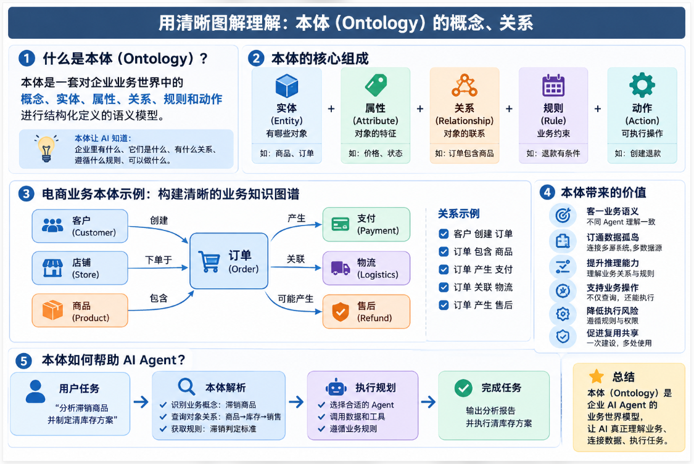
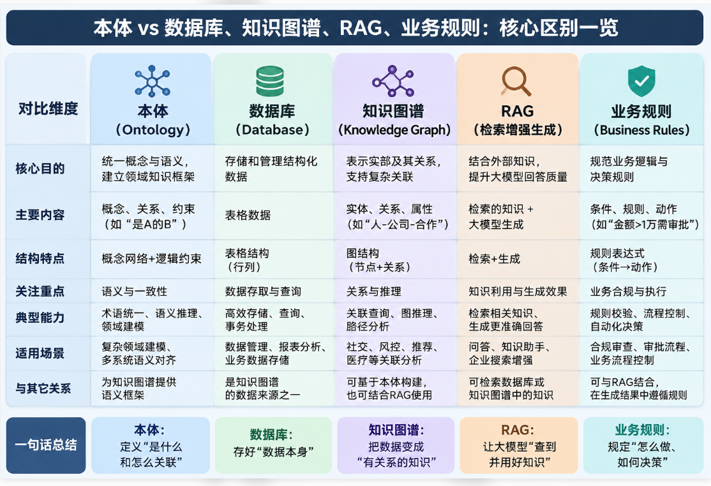

# 一、什么是本体（Ontology）

在人工智能、知识工程和企业 AI Agent 系统中，**本体（Ontology）是一套对现实世界中的业务对象、概念、属性、关系、规则和约束进行结构化定义的知识模型。**

简单来说：

> 本体就是让 AI 知道：企业里有什么东西、这些东西是什么、它们之间有什么关系、它们遵循什么规则，以及什么情况下可以执行什么操作。

它解决的不是简单的知识存储问题，而是 **让 AI 理解企业业务世界的语义（Business Semantics）**。

举个例子。

假设一个电商企业有以下业务数据：

- 商品：iPhone 17 Pro
- 店铺：Apple 官方旗舰店
- 订单：ORD20261109001
- 客户：张先生
- 库存：深圳仓库剩余 120 件
- 退款：订单退款 399 元

这些数据在数据库里可能只是几张表：

```text
products
shops
orders
customers
inventory
refunds
```

传统数据库知道字段和数据类型，却不天然理解：

- 商品属于哪个店铺？
- 订单包含哪些商品？
- 订单属于哪个客户？
- 退款对应哪个订单？
- 库存属于哪个仓库？
- 哪些订单允许退款？
- 退款金额是否可以超过实际支付金额？
- 商品缺货时，哪些营销活动需要暂停？

这些问题涉及业务语义、业务关系和业务规则。

本体就是把这些内容统一描述出来。

例如，可以将电商业务抽象为：

```text
                ┌──────────┐
                │   客户   │
                └────┬─────┘
                     │ 创建
                     ▼
                ┌──────────┐
                │   订单   │
                └────┬─────┘
                     │ 包含
                     ▼
                ┌──────────┐
                │   商品   │
                └────┬─────┘
                     │ 存储于
                     ▼
                ┌──────────┐
                │   仓库   │
                └──────────┘

订单 ──产生──> 支付记录
订单 ──关联──> 物流单
订单 ──产生──> 售后申请
售后申请 ──触发──> 退款
商品 ──参与──> 营销活动
```

这张图表达的不仅仅是数据之间的关联，更重要的是企业业务世界中的真实含义。

## **1.1 本体的核心概念组成**

一个企业级业务本体，通常包含以下六个基本组成部分。

| 组成部分 | 英文                 | 解决的问题                 | 电商示例             |
| -------- | -------------------- | -------------------------- | -------------------- |
| 实体     | Entity / Class       | 企业有哪些业务对象         | 商品、订单、客户     |
| 属性     | Attribute / Property | 对象具有什么特征           | 商品价格、订单状态   |
| 关系     | Relationship         | 对象之间有什么联系         | 订单包含商品         |
| 事件     | Event                | 发生了什么事情             | 订单支付、库存扣减   |
| 规则     | Rule / Constraint    | 业务应该遵循什么约束       | 退款不能超过实付金额 |
| 动作     | Action               | 可以对业务对象执行什么操作 | 创建退款、调整库存   |

需要注意：严格来说，OWL 等形式化本体语言主要描述概念、属性、关系和逻辑约束；事件和动作通常是企业操作本体、领域模型或本体驱动应用的扩展。

## 1.2 图解本体核心概念



(AI 画图)

# 二、本体与数据库、知识图谱、RAG、业务规则有什么区别？

这是理解本体在 Agent 系统中作用的关键。它们经常一起出现，但承担的职责不同。

| 技术                        | 核心职责                 | 主要回答的问题             |
| --------------------------- | ------------------------ | -------------------------- |
| 数据库（Database）          | 存储结构化数据           | 数据在哪里？               |
| 知识图谱（Knowledge Graph） | 存储实体及其关系实例     | 具体对象之间有什么关系？   |
| 本体（Ontology）            | 定义业务概念、关系和语义 | 这些对象代表什么？         |
| RAG                         | 检索外部知识和文档       | 哪些资料可以帮助回答问题？ |
| 业务规则引擎                | 判断业务条件和约束       | 这个操作是否符合规则？     |
| API / Tool                  | 提供系统能力             | 如何查询或操作业务系统？   |



(AI 画图)

用一个例子区分 - 假设 Agent 收到任务：

**检查商品 A 是否可以参加双十一促销，并在满足条件时创建营销活动。**

不同技术承担的职责：

1. 数据库：查询商品价格、库存、销量。
2. 知识图谱：查询商品属于哪个店铺、关联哪些供应商和活动。
3. 本体：理解商品、店铺、库存、促销活动之间的业务含义。
4. RAG：检索双十一活动政策和运营规范。
5. 规则引擎：判断库存、利润率、活动价格是否满足要求。
6. Tool Gateway：调用电商平台 API 创建营销活动。

**本体不是数据库的替代品，也不是知识图谱的另一个名字。它是帮助这些数据和系统形成统一业务语义的基础。**

# 三、本体在 AI Agent 应用中到底有什么作用？

传统 LLM Agent 通常采用这样的工作方式：

```
用户提出任务
    ↓
LLM 理解用户意图
    ↓
LLM 根据上下文选择 Tool
    ↓
调用 API
    ↓
获得执行结果
    ↓
LLM 组织结果并回复
```

这种方式在简单任务中表现不错，但在企业级复杂业务中存在明显问题。

例如用户对电商运营 Agent 说：

> 帮我找出最近销量下降、库存积压的商品，分析原因，并制定清库存方案。

Agent 需要完成：

1. 查询商品销售数据。
2. 查询库存数据。
3. 识别销售下降的商品。
4. 判断是否属于库存积压。
5. 查询商品所属店铺、类目和供应商。
6. 分析价格、促销、广告等影响因素。
7. 制定清库存策略。
8. 评估策略是否符合利润率要求。
9. 创建营销活动或提交审批。

这里有一个非常重要的问题：

**LLM 并不知道企业内部这些业务对象究竟意味着什么，也不知道它们之间完整的业务关系。**

它可能知道什么是商品、库存、订单，但不一定知道：

- 企业如何定义滞销商品？
- 什么样的库存才算库存积压？
- 库存周转天数如何计算？
- 哪个商品属于哪个运营团队？
- 哪个店铺允许调整商品价格？
- 哪种促销需要主管审批？
- 哪些商品不能参加清库存活动？

这些知识如果全部放在 Prompt 中，会出现上下文越来越庞大、知识重复、不同 Agent 理解不一致等问题。

如果全部交给 Tool，也会出现大量零散 API，Agent 不知道什么时候调用哪个 API，以及多个 API 之间的业务关系。

**本体的价值，就是给 Agent 提供一个统一的、结构化的、可查询、可推理、可操作的企业业务世界模型。**

## **3.1 解决 Agent 的六大痛点**

| Agent 原有痛点 | 具体表现                         | 本体提供的解决方式             |
| -------------- | -------------------------------- | ------------------------------ |
| 业务理解不准确 | 不理解企业内部业务术语           | 统一业务概念和语义             |
| 数据孤岛       | ERP、OMS、电商平台数据分散       | 统一业务对象和关系             |
| 上下文缺失     | 不知道商品、订单、客户之间的关系 | 提供业务关系网络               |
| Tool 选择困难  | 不知道应该调用哪个工具           | 将业务对象与动作关联           |
| 推理能力有限   | 缺少隐含业务关系和约束           | 通过语义规则与逻辑推理补充信息 |
| 执行风险高     | 不清楚操作权限和业务约束         | 将权限、动作条件和治理规则关联 |

我们进一步看几个典型场景。

### **场景一：解决 Agent 不理解企业业务的问题**

用户说：

> 找出本周需要重点关注的滞销商品。

没有本体时：

```
LLM
  ↓
猜测什么叫滞销
  ↓
查询商品销售数据
  ↓
根据模型自身知识进行判断
```

问题是不同 Agent 可能采用不同的滞销标准。

有了本体：

```
用户请求
   ↓
识别业务概念：滞销商品
   ↓
查询企业本体定义
   ↓
滞销商品判定规则
   ├── 近30天销量
   ├── 库存数量
   ├── 库存周转天数
   ├── 最近销售趋势
   └── 商品生命周期
   ↓
调用对应数据服务
   ↓
按照企业定义识别商品
```

这样，商品运营 Agent、数据分析 Agent、营销 Agent 就可以共享同一套业务定义。

### **场景二：解决 Agent 不知道数据之间关系的问题**

例如：

> 为什么商品 A 最近销量下降？

Agent 不应该只查询商品销售表。

它应该知道：

```
商品 A
  ├── 属于 → 店铺 X
  ├── 属于 → 商品类目 Y
  ├── 由 → 供应商 Z 供货
  ├── 存储于 → 仓库 W
  ├── 参与 → 营销活动 M
  ├── 投放于 → 广告计划 N
  └── 产生 → 销售订单
```

这样 Agent 才能沿着业务关系进一步分析：

- 是否出现库存不足？
- 是否价格上涨？
- 是否促销结束？
- 是否广告预算减少？
- 是否类目整体销量下降？
- 是否竞争商品价格发生变化？

本体提供关系定义，知识图谱或对象查询服务提供实际关系数据，Agent 根据任务沿关系进行查询。

### **场景三：解决 Agent 只会调用 API，却不理解业务操作的问题**

例如：

> 把这批滞销商品降价 10%。

传统 Agent 可能直接调用：

```
updateProductPrice()
```

但企业真实业务远远不止一个 API。

它必须知道：

- 哪些商品允许降价？
- 最低售价是多少？
- 是否低于成本价？
- 是否影响正在进行的营销活动？
- 是否需要运营主管审批？
- 哪个店铺有操作权限？

通过本体可以定义：

```
业务对象：Product

业务动作：AdjustPrice

输入参数：
  productId
  newPrice
  reason

执行约束：
  newPrice >= minimumAllowedPrice

关联权限：
  Product.Price.Adjust

审批要求：
  根据降价幅度和风险等级判断

执行结果：
  PriceAdjustmentRecord
```

Agent 不再只是知道一个 API，而是知道一个有业务含义的动作，以及这个动作的条件和后果。

这里要强调：本体负责表达对象、动作和业务语义；真正的权限校验、审批执行和交易一致性，仍然必须由权限引擎、规则引擎和业务服务负责。