## 一、LLM 到底是什么？

**LLM = Large Language Model，大语言模型**。

大语言模型是一类通过大量文本及其他数据进行训练，能够理解和生成语言，并完成总结、翻译、问答、代码生成等任务的人工智能模型。

我们每天使用的 AI 助手，能够回答问题、撰写文章、解释代码，甚至帮助规划复杂工作。它们背后的一项核心技术，就是 LLM。

那么，LLM 究竟是什么？它是一个巨大的数据库吗？是一个装满知识的机器人吗？还是一台特别聪明的计算机？

可以先把它理解为：一个通过学习大量数据，掌握语言中的规律，并根据当前输入生成后续内容的模型。

例如，你输入：

“太阳从东方……”

模型很可能接着生成“升起”。

为什么？因为它在训练过程中学习到了大量语言表达中的规律，知道这几个字后面通常会出现什么内容。

但现代 LLM 并不只是简单地接龙。经过大规模预训练和后续训练后，它还能利用上下文完成推理、信息提取、指令执行和多步骤问题求解。

⚠️ 需要注意的是，模型生成的内容不一定正确。它学习的是数据中的模式，并不是自动拥有一个始终准确的事实数据库。

## 二、用一张图理解 LLM 的基本原理

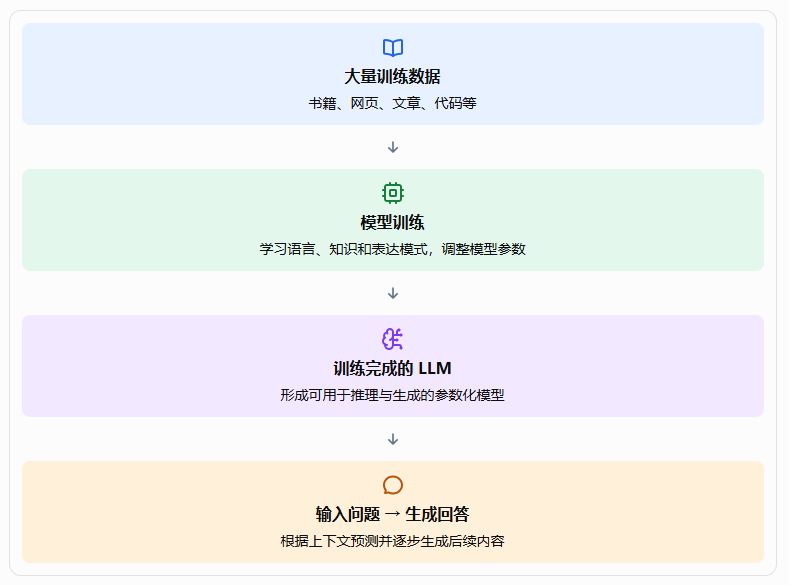

这张图展示了 LLM 的基本过程：先通过训练学习规律，再在实际使用时，根据用户提供的内容生成输出。

下面我们逐步拆解其中的关键概念。

## 三：LLM 是如何学习语言的？

### 1. 第一步：学习大量数据

在训练阶段，模型会接触大量文本，例如书籍、网页、百科资料、技术文档和代码等。具体训练数据取决于模型开发者的选择和数据处理流程。

可以把这看成一个学习过程：模型接触大量不同的表达方式，从中学习词语之间的关系、句子的结构、概念之间的联系，以及不同问题通常对应什么样的回答。

例如：

- “水在标准大气压下，约 100℃ 沸腾。”
- “Python 是一种编程语言。”
- “如果明天下雨，户外活动可能需要调整。”

模型在训练过程中会逐渐学习这些文本中的统计规律和结构关系。

不过，模型不是像人一样读完每本书，就把每个句子完整地记进大脑。训练的核心是利用数据调整模型内部的大量数值参数，使模型能够更好地预测训练数据中的后续内容。

### 2. 第二步：理解 Token（词元）

计算机并不是直接以人类的完整句子进行神经网络计算。输入文本通常会先被切分成一系列 Token，也叫词元。

Token 可能是一个汉字、一个词、一个词的一部分、标点符号或其他文本片段，具体取决于使用的分词器。

例如，下面这句话：

原始文本 

> **我正在学习大语言模型**

示意性 Token 切分（并非特定模型的真实切分结果）

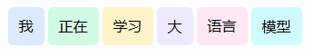

Token 是文本处理的基本单位。模型先将 Token 转换为数字 ID，再将其映射为向量，交给神经网络处理。

为什么要这样做？因为计算机需要把文本转化为可以计算的数值表示。

### 3. 第三步：学习预测下一个 Token

现代许多通用 LLM 都采用自回归生成方式，即根据前面的内容预测接下来可能出现的 Token。

例如：

输入：“今天的天气非常……”

模型可能预测：

- 好
- 热
- 寒冷

模型会根据上下文，为候选 Token 计算相应的概率分布，再依据生成策略选择下一个 Token。

如果选择了“好”，输入就变成“今天的天气非常好”，模型接着预测下一个 Token，如此循环，逐步形成完整的回答。

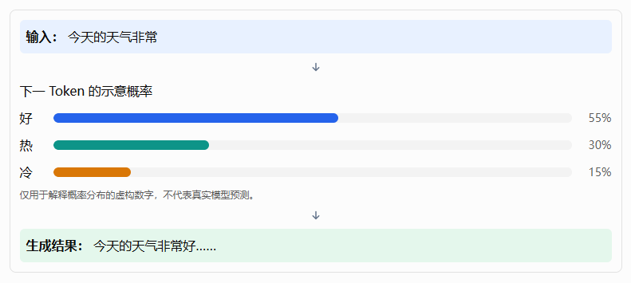

这也解释了为什么同一个问题重复提问，有时会得到不同的回答。生成过程可能受到采样策略、温度参数、上下文和系统设置的影响。

但需要强调：预测下一个 Token 是很多 LLM 的核心训练目标和生成机制，并不意味着模型只会机械地接龙。 为了更好地预测复杂文本，模型需要学习语言结构、概念联系和多种任务模式，因此能够表现出复杂的问题解决能力。

## 四、LLM 为什么能够理解复杂的问题？

如果 LLM 只是预测下一个 Token，那么它为什么能够解释数学题、编写程序，甚至制定商业计划？

关键在于它的模型结构，以及训练过程中形成的复杂表示能力。

### 1.神经网络：模型的大脑

LLM 通常建立在深度神经网络之上。神经网络由大量计算单元和连接参数组成，输入信息经过多层计算，逐渐形成更适合当前任务的内部表示。

可以把它想象成一系列信息处理步骤：

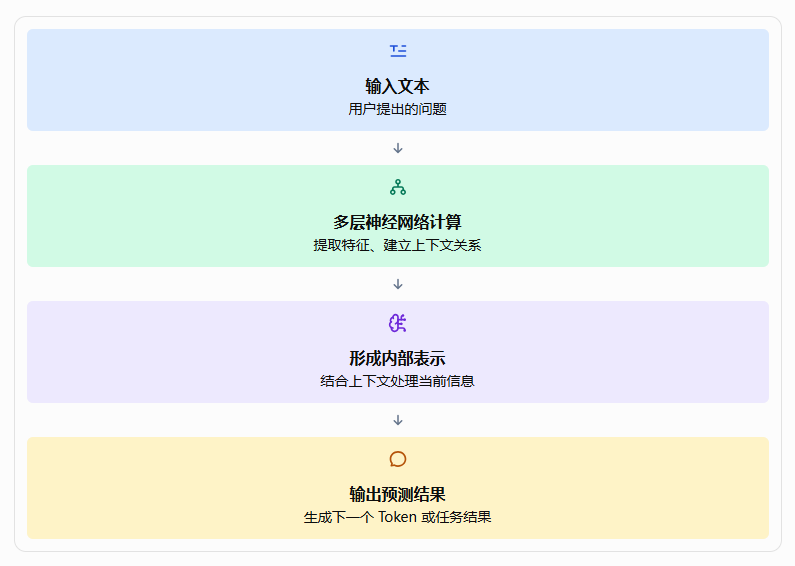

这里的“内部表示”很重要。模型并不是只把输入的字面形式进行简单匹配，而是通过训练形成能够表达多种关系的数值表示。

例如，当用户问“苹果为什么会从树上掉下来”时，模型可能结合“苹果”“树”“掉落”等概念之间的关系，生成与重力有关的解释。

当然，这种能力来自模型训练形成的内部计算机制，并不意味着模型具有和人类完全相同的理解方式。

### 2.Transformer：现代 LLM 的关键架构

目前许多主流 LLM 都基于 Transformer 架构，或者采用从 Transformer 发展而来的结构。

Transformer 的重要能力之一是通过注意力机制（Attention），根据当前任务处理不同 Token 之间的关系。

例如：

“张三把书放在桌子上，因为它太重了。”

这里的“它”指什么，需要结合句子上下文判断。注意力机制能够帮助模型计算不同位置的信息对当前处理有多重要。

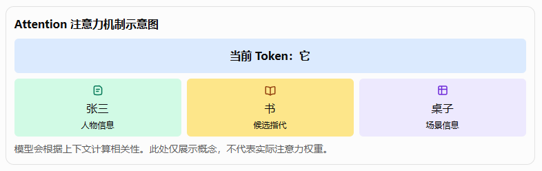

注意力机制让模型可以综合多个位置的信息，而不是只看紧邻当前 Token 的几个字。

Transformer 还包含其他关键组件，例如前馈网络、残差连接和归一化等。它们共同支持深层网络中的信息处理与训练。

对于初学者来说，先记住三个概念就足够了：

- Token：模型处理文本的基本单位。
- Attention：帮助模型结合上下文中的不同信息。
- Transformer：组织这些计算的核心神经网络架构之一。

### 3.参数：模型从训练中学到了什么？

模型参数是神经网络中通过训练调整的大量数值。可以粗略地把参数理解为模型内部学习到的可调节数值。

模型训练时，会比较预测结果与训练目标之间的差异，通过优化算法不断调整参数，让后续预测更符合训练目标。

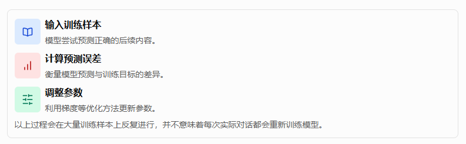

参数规模是描述模型大小的一个重要指标，例如十亿参数（1B）、百亿参数（10B）等。但参数数量并不能单独决定模型能力。训练数据质量、模型结构、训练方法、推理策略和后续对齐等因素同样重要。

## 五、LLM 是怎样训练出来的？

一个能够直接用于用户交互的 LLM，通常不是仅完成一次训练就能得到的。可以把整个过程分成三个主要阶段。

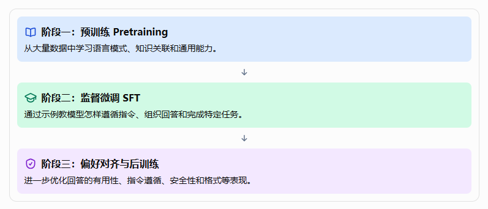

### 1.预训练：打好基础

预训练通常使用大量文本或其他模态的数据，让模型学习语言结构、概念关系和生成规律。

例如，模型通过大量代码学习编程语法和常见模式，通过科学文本学习科学领域的表达和概念关系。

预训练通常消耗大量计算资源，也是形成通用能力的重要阶段。

### 2.监督微调：学会听懂指令

一个完成预训练的模型，未必能够很好地按照用户要求回答问题。

监督微调（SFT）会使用问题与示范答案等训练样本，让模型学习如何完成指令任务。

例如：

- 输入：“请用三句话总结这篇文章。”
- 示范输出：一段符合三句话要求的摘要。

通过大量类似的样本，模型可以逐渐学会遵循指令、使用合适的表达形式，并按照要求输出内容。

### 3.偏好对齐：让回答更符合使用需求

同一个问题可能存在多个合理答案，但有些答案更准确、更清楚，也更符合用户的需求。

后训练可以利用人工反馈、偏好数据、奖励模型或其他优化方法，让模型更倾向于生成高质量回答。RLHF（基于人类反馈的强化学习）是其中一种方法，并不是所有模型都采用完全相同的训练流程。

还需要强调：模型对齐不等于模型永远正确，也不能完全消除偏见、错误或不安全输出。真正的企业应用仍然需要外部校验、权限控制和评估机制。

## 六、模型训练完成后，回答问题时发生了什么？

训练和使用模型是两件不同的事情。

- **训练（Training）**：通过大量数据调整模型参数，让模型形成相应的能力。
- **推理（Inference）**：使用训练完成的模型，根据输入计算输出结果。

当你向 AI 助手提问时，通常发生的是推理，而不是从头训练模型。

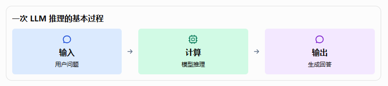

例如，你问：“什么是数据库索引？”

模型会根据输入内容计算下一个 Token，并逐步生成解释。生成过程中，已经生成的内容通常也会成为后续生成的上下文。

实际部署时，推理还涉及显存和内存管理、批处理、KV Cache、并发请求等工程问题。对于使用云端模型的应用，这些计算往往由模型服务提供商完成；如果在本地运行模型，则需要自己准备相应的计算资源。

## 七、什么是上下文窗口？为什么模型会忘记前面的内容？

上下文窗口（Context Window）可以理解为：模型在一次推理中能够处理的上下文 Token 容量上限。

例如，在一个对话中，系统可能向模型提供：

- 当前用户问题；
- 前面的部分对话历史；
- 系统指令；
- 检索到的知识文档；
- 工具调用结果；
- 其他任务相关信息。

这些内容都会占用上下文容量。具体容量取决于模型及其配置，不能认为所有模型都具有相同的上下文长度。

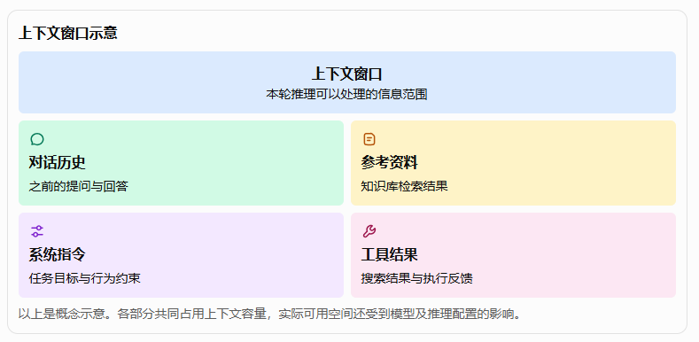

这也解释了为什么在长对话中，AI 有时会遗漏早期信息。应用可能只保留部分历史，或者使用摘要、检索和记忆机制管理上下文。

在企业级 Agent 系统中，这类问题通常通过 Context Engineering、Memory 和 RAG 等技术协同解决，而不是单纯地不断增加对话长度。

## 八、为什么 LLM 有时会一本正经地说错话？

LLM 的一个重要局限是可能产生幻觉（Hallucination），也就是生成看似合理、实际上不准确或缺乏依据的内容。

例如，你要求模型介绍一本不存在的书，它可能根据常见的书籍介绍格式，生成作者、出版年份和内容简介，甚至看起来十分可信。

为什么会这样？

首先，模型的核心生成机制并不等于事实核验。它可能生成符合语言模式的内容，却没有可靠证据证明这些内容是真的。

其次，模型可能没有掌握问题所需的信息。例如，某个问题涉及刚刚发生的新闻，而模型没有获取实时资料。

再次，模糊的问题、不完整的上下文或相互矛盾的材料，也可能导致错误答案。

因此，在企业应用中，可以采用以下方法降低风险：

- **RAG 检索**：让模型参考相关文档，而不是完全依赖参数中学到的知识。
- **外部工具**：通过搜索、数据库查询或业务 API 获取实际数据。
- **结果验证**：使用规则、程序或独立验证流程检查关键输出。
- **来源引用**：要求回答关联可核验的资料来源。
- **人工审核**：对财务、法律、医疗或重要业务决策等高风险场景设置适当的审核机制。

需要注意，这些措施只能降低错误风险，不能保证所有输出都绝对正确。

## 九、LLM、RAG 和 Agent 有什么区别？

这是学习 AI 应用架构时最容易混淆的三个概念。

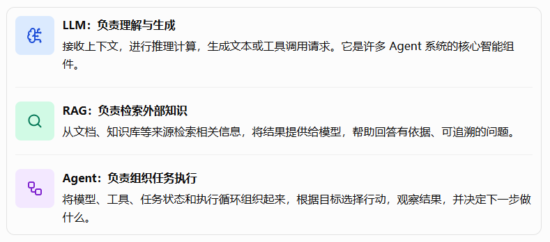

举一个实际例子：用户要求“分析本季度销售情况，找出下降原因，并生成报告”。

1. LLM 理解任务并协助分析问题。
2. RAG 可以检索销售分析规范、产品资料和历史报告。
3. Agent 可以调用数据库工具获取真实销售数据，执行计算，检查分析结果，再生成报告。
4. 最终由应用将报告保存并展示给用户。

这里的关键区别是：LLM 提供语言智能，RAG 补充检索知识，Agent 负责组织和执行任务。 它们不是相互替代的关系，而是可以组合使用的不同技术能力。

## 十、学习 LLM 后，应该掌握哪些核心概念？

如果你准备进一步学习 AI 应用开发，建议按照下面的顺序理解这些概念。

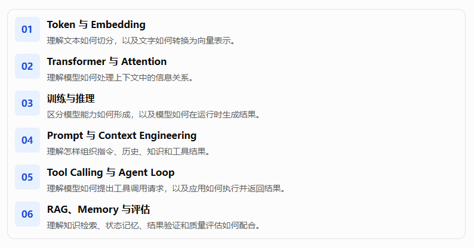

**01、Token 与 Embedding**

理解文本如何切分，以及文字如何转换为向量表示。

**02、Transformer 与 Attention**

理解模型如何处理上下文中的信息关系。

**03、训练与推理**

区分模型能力如何形成，以及模型如何在运行时生成结果。

**04、Prompt 与 Context Engineering**

理解怎样组织指令、历史、知识和工具结果。

**05、Tool Calling 与 Agent Loop**

理解模型如何提出工具调用请求，以及应用如何执行并返回结果。

**06、RAG、Memory 与评估**

理解知识检索、状态记忆、结果验证和质量评估如何配合。

## 十一、总结

LLM 是现代人工智能应用的重要基础。它通过大规模训练学习数据中的模式，利用神经网络处理输入，再通过推理逐步生成输出。

理解 LLM，最重要的是把握五个要点：

1. 数据：模型从训练数据中学习规律。
2. Token：文本被切分为模型能够处理的基本单位。
3. 参数与神经网络：模型通过训练调整参数，形成内部表示能力。
4. 推理与生成：模型根据当前上下文计算并生成后续内容。
5. 局限与应用：模型可能产生错误，因此实际系统需要检索、工具、验证和安全机制。

LLM 本身已经具备很强的语言处理能力，但要将它转化为能够完成真实工作的企业级系统，还需要进一步理解上下文工程、工具调用、Agent Runtime、工作流、记忆和评估等技术。

从这个角度看，学习 LLM 不只是学习一个模型，而是理解后续整套 AI 应用架构的起点。
