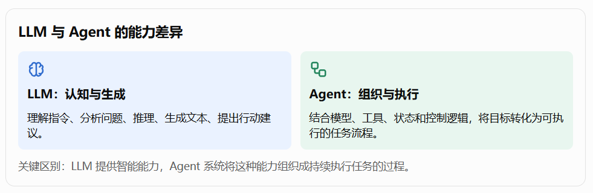
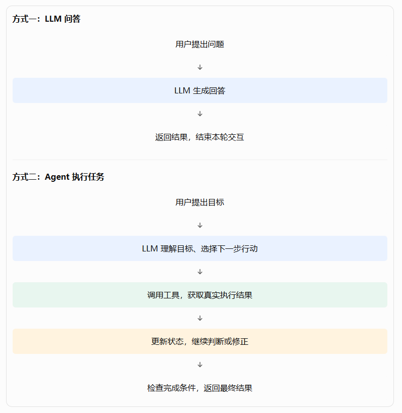
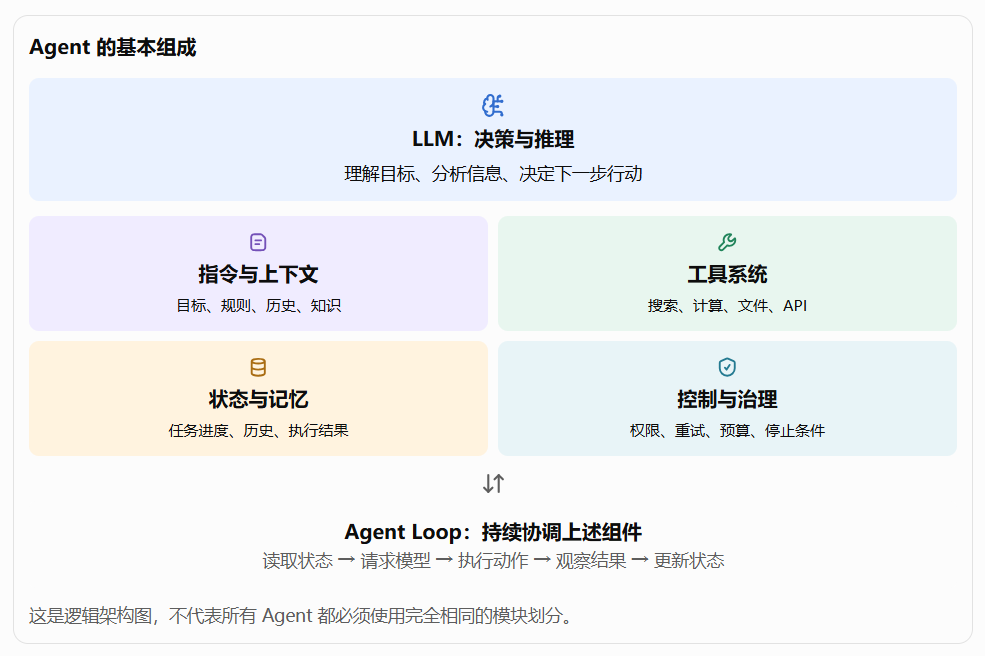
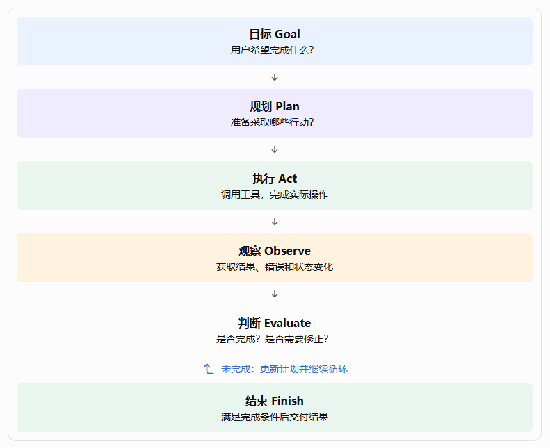
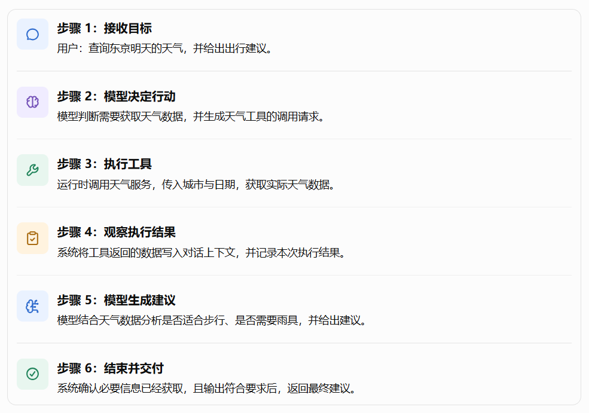
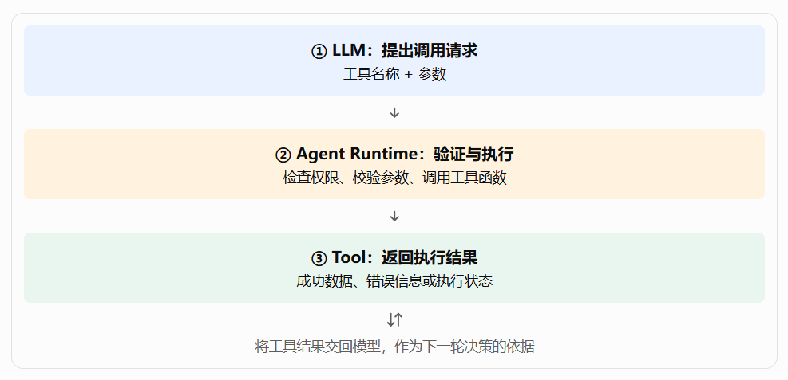
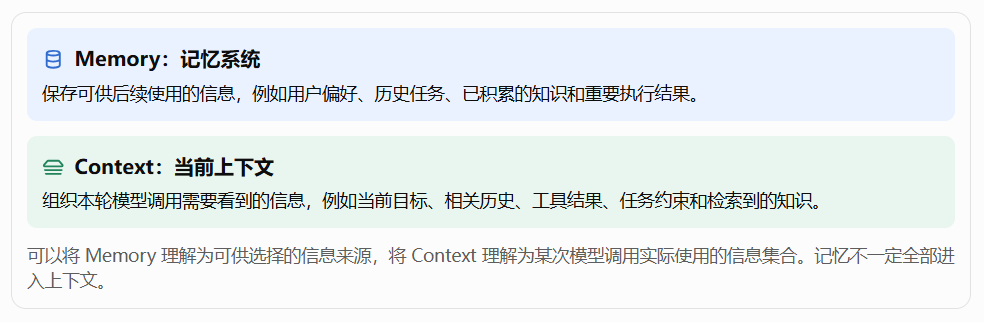
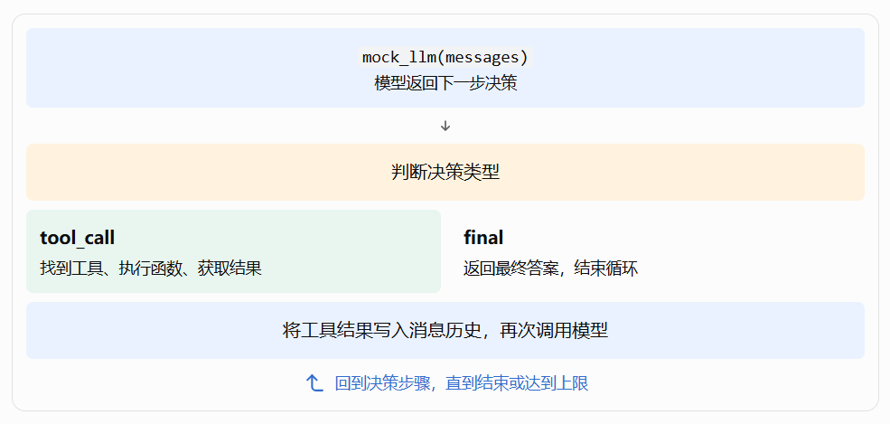

**第三篇：从 LLM 到 Agent——理解 Agent 的基本组成与运行机制**

在前两篇中，我们已经认识了 LLM（大语言模型），并从整体上了解了 Agent 系统的分层架构。

接下来，需要回答一个更关键的问题：

一个只能接收文本、生成文本的大语言模型，究竟是如何变成一个能够理解目标、制定计划、调用工具、执行任务、检查结果，并在失败后继续尝试的智能系统的？

理解这个问题，是从认识大模型迈向开发 Agent 应用的关键一步。

本篇将从一个简单的例子出发，逐步拆解 Agent 的基本组成、核心运行循环、工具调用机制、任务状态管理，以及从 LLM 到 Agent 的完整演进过程。我们不仅要理解 Agent 是什么，还要为后续使用 Python 实现 Agent Loop、工具系统、记忆系统和 Agent Runtime 打下基础。

## 一、为什么有了 LLM，还需要 Agent？

### 1.1 LLM 能做什么，又不能独立完成什么？

假设你向一个大语言模型提出这样的需求：

> 帮我分析最近一周的人工智能行业动态，筛选出最值得关注的 5 个话题，分别撰写一篇适合微信公众号发布的文章，并将结果保存到本地文件中。

这是一个典型的内容生产任务，包含多个步骤：

- 获取最近一周的行业动态。
- 筛选和分析热点话题。
- 确定文章选题。
- 撰写文章。
- 检查文章质量。
- 将文章保存为文件。

LLM 可以理解需求、分析信息、生成选题和撰写文章，但它本身并不天然具备访问互联网、操作本地文件、持续跟踪任务进度等能力。

这里需要区分两个概念：

模型的智能能力与系统的执行能力不是同一回事。

**LLM 与 Agent 的能力差异**

LLM：认知与生成 - 理解指令、分析问题、推理、生成文本、提出行动建议。

Agent：组织与执行 - 结合模型、工具、状态和控制逻辑，将目标转化为可执行的任务流程。

关键区别：LLM 提供智能能力，Agent 系统将这种能力组织成持续执行任务的过程。



当然，现代模型也可以通过 API、内置搜索或其他集成能力完成部分操作。但这些操作背后仍然需要相应的执行环境、接口和控制机制。

### 1.2 从回答问题到完成任务

我们可以将 LLM 和 Agent 的区别理解为两种不同的工作方式。

#### 方式一：LLM 问答

用户提出问题 -> LLM 生成回答 -> 返回结果，结束本轮交互

#### 方式二：Agent 执行任务

用户提出目标 -> LLM 理解目标、选择下一步行动 -> 调用工具，获取真实执行结果 -> 更新状态，继续判断或修正 -> 检查完成条件，返回最终结果



需要注意，Agent 并不意味着每个任务都必须多次调用模型。有些简单任务一次模型调用就可以完成；另一些任务则需要几十次甚至更多步骤。真正的区别在于，系统是否具有根据执行结果继续决策和推进任务的机制。

## 二、Agent 到底是什么？

### 2.1 一个容易理解的定义

Agent（智能体）是一种能够围绕目标进行决策，并通过执行行动不断推进任务的系统。

在 LLM 应用开发中，我们可以将它理解为：

**Agent = LLM + 指令与上下文 + 工具 + 状态管理 + 执行循环 + 控制机制**。

这个公式不是严格的数学定义，而是一种便于工程实践的理解方式。不同框架可能将这些能力组合在一起，也可能拆分为不同的模块。

例如：

- LLM 负责理解、推理和生成行动建议。
- 指令与上下文告诉模型任务目标、约束和当前已知信息。
- 工具让模型能够访问外部系统并执行操作。
- 状态管理记录任务进度、执行结果和中间产物。
- 执行循环让系统能够根据结果继续行动。
- 控制机制负责处理错误、权限、预算、超时和停止条件。

#### Agent 的基本组成

- LLM 决策与推理 ：理解目标、分析信息、决定下一步行动

- 指令与上下文：目标、规则、历史、知识

- 工具系统：搜索、计算、文件、API

- 状态与记忆：任务进度、历史、执行结果

- 控制与治理：权限、重试、预算、停止条件

Agent Loop：持续协调上述组件

> 读取状态 → 请求模型 → 执行动作 → 观察结果 → 更新状态

这是逻辑架构图，不代表所有 Agent 都必须使用完全相同的模块划分。



### 2.2 为什么不能简单地把 Agent 等同于 LLM？

因为模型只负责整个系统中的一部分工作。

假设模型输出了这样一段内容：

```
我将搜索最近一周的 AI 行业新闻，
筛选 5 个热点，
然后为每个热点撰写一篇文章。
```

这只是一个行动计划，不意味着这些工作已经完成。

系统还必须解决以下问题：

1. 应该调用哪个搜索接口？
2. 如何将模型提出的行动转换为真实的函数调用？
3. 如何获取工具执行后的返回值？
4. 如何让模型看到执行结果？
5. 如果搜索失败，应该重试还是跳过？
6. 如果只完成了 3 篇文章，如何继续完成剩余任务？
7. 如何判断最终结果达到了用户要求？

这些问题都属于 Agent 系统工程，而不仅仅是提示词设计。

因此，开发 Agent 应用不仅要关注模型本身，还需要设计模型外围的执行环境和控制流程。

## 三、Agent 的核心：从目标到行动

### 3.1 Agent 如何理解用户的目标？

用户通常不会直接告诉 Agent 每一步应该调用什么工具，而是描述自己想要的结果。

例如：

> 帮我整理本周的项目进展，找出延期风险，并生成一份项目周报。

这是一个目标描述，而不是明确的执行指令。

Agent 需要将目标转换为一系列可以执行、检查和追踪的工作。

一种简单的拆解方式是：

| 子任务    | 执行动作          | 完成标准       |
| ------ | ------------- | ---------- |
| 收集项目数据 | 查询任务系统        | 获取相关任务与进度  |
| 分析项目状态 | 比较计划与实际进度     | 识别延期和阻塞项   |
| 形成风险结论 | 结合截止时间和任务依赖分析 | 输出风险及依据    |
| 生成周报   | 组织分析结果并撰写内容   | 生成符合模板的周报  |
| 保存交付物  | 调用文件工具        | 文件成功保存并可访问 |

这个过程可以称为任务分解（Task Decomposition）。

但需要注意：任务分解不一定要由单独的 Planner 模块完成。简单任务可以由模型直接判断下一步行动；复杂任务则可以先生成计划，再逐项执行。

### 3.2 计划不等于执行

这是理解 Agent 时非常重要的一点。

假设模型制定了以下计划：

```
1. 查询项目管理系统。
2. 统计延期任务。
3. 分析风险原因。
4. 生成项目周报。
5. 保存周报文件。
```

计划只是一个待执行的方案。执行过程中可能出现：

- 项目管理系统不可用。
- 某些任务缺少截止日期。
- 风险分析发现了新的依赖关系。
- 文件保存失败。
- 用户临时要求增加预算分析。

Agent 不能只按照原计划机械地执行到底，而应该结合真实结果调整后续行动。

因此，Agent 的运行过程通常具有反馈机制：

```python
目标 Goal - 用户希望完成什么？

规划 Plan - 准备采取哪些行动？

执行 Act - 调用工具，完成实际操作

观察 Observe - 获取结果、错误和状态变化

判断 Evaluate - 是否完成？是否需要修正？

未完成：更新计划并继续循环

结束 Finish

满足完成条件后交付结果
```




这里的 Goal、Plan、Act、Observe、Evaluate 是一种用于教学的逻辑划分，不意味着必须在程序中实现五个独立的 Agent。

对于简单应用，可以由一个模型和一个执行循环完成这些工作。随着业务复杂度增加，再逐步引入独立规划器、结果验证器、工作流引擎等组件。

## 四、Agent 的关键机制：Agent Loop

如果说 LLM 提供了推理能力，那么 Agent Loop 就是让系统能够持续行动的关键机制之一。

### 4.1 什么是 Agent Loop？

Agent Loop（智能体执行循环）是指：系统在执行任务期间，反复请求模型决定下一步行动、执行行动、获取结果，并根据结果决定继续还是结束。

它解决了一个基本问题：

**模型完成一次推理后，系统如何继续推进任务，而不是直接结束？**

最简单的 Agent Loop 可以抽象为：

```python
while 任务尚未结束:
    读取当前任务状态
    将目标和上下文发送给 LLM
    获取模型的下一步决策

    if 模型要求调用工具:
        执行工具
        获取执行结果
        更新任务状态
    else if 模型决定结束:
        检查是否允许结束
        返回最终结果
```

这段伪代码展示了基本结构，但真正的生产系统还需要处理模型调用失败、工具超时、无效参数、重复调用、用户取消和资源限制等情况。

### 4.2 一次完整的 Agent Loop 会发生什么？

以“查询天气并生成出行建议”为例，假设 Agent 已经配置了天气查询工具。

```python
步骤 1：接收目标

用户：查询东京明天的天气，并给出出行建议。

步骤 2：模型决定行动

模型判断需要获取天气数据，并生成天气工具的调用请求。

步骤 3：执行工具

运行时调用天气服务，传入城市与日期，获取实际天气数据。

步骤 4：观察执行结果

系统将工具返回的数据写入对话上下文，并记录本次执行结果。

步骤 5：模型生成建议

模型结合天气数据分析是否适合步行、是否需要雨具，并给出建议。

步骤 6：结束并交付

系统确认必要信息已经获取，且输出符合要求后，返回最终建议。
```



这里有一个值得特别注意的细节：工具调用请求与工具执行是两个不同的动作。

模型可以提出调用天气工具的请求，但真正连接天气服务、验证参数、执行请求和返回结果的，是 Agent 运行时及工具实现。

### 4.3 Agent Loop 的终止条件

一个可靠的 Agent 不能无限循环。

至少需要考虑以下终止条件：

| 条件     | 含义              |
| ------ | --------------- |
| 正常完成   | 任务已经满足完成标准      |
| 最大步数   | 执行次数达到上限        |
| 时间限制   | 任务超过允许的执行时间     |
| 预算限制   | 模型调用或工具执行成本达到上限 |
| 用户取消   | 用户主动停止任务        |
| 不可恢复错误 | 继续执行已无意义或不安全    |
| 等待人工确认 | 任务进入暂停状态，等待授权   |

其中，等待人工确认与任务完成不同。

例如，Agent 已经准备好向客户发送邮件，但系统要求用户确认。此时任务应该进入等待状态，而不是将其当作已经完成。

后续开发中，我们会把这些条件进一步实现为任务状态机、超时控制、重试机制和人工审批流程。

## 五、工具系统：让 Agent 能够真正执行操作

### 5.1 为什么 Agent 需要工具？

没有工具（Tool）时，模型主要依靠输入上下文进行推理和生成。

接入工具后，模型可以请求系统执行外部操作，例如：

- 通过搜索工具获取最新信息。
- 通过数据库工具查询业务数据。
- 通过计算工具执行精确计算。
- 通过文件工具读取和保存文件。
- 通过业务 API 创建任务、更新订单或发送消息。

工具（Tool）是 Agent 与外部世界交互的重要接口。

不过，工具并不一定都是外部服务。它既可以是一个 Python 函数，也可以是一个远程 HTTP API、数据库查询接口或 MCP Server 提供的能力。

### 5.2 模型是如何调用工具的？

通常，工具调用涉及三个环节。

```python
① LLM：提出调用请求

工具名称 + 参数

② Agent Runtime：验证与执行

检查权限、校验参数、调用工具函数

③ Tool：返回执行结果

成功数据、错误信息或执行状态


将工具结果交回模型，作为下一轮决策的依据
```



以天气查询为例，模型可能生成类似下面的结构化请求：

```json
{
  "tool": "get_weather",
  "arguments": {
    "city": "Tokyo",
    "date": "tomorrow"
  }
}
```

这只是一个用于说明的简化格式。实际模型 API 可能采用不同的工具调用协议，并通过专门的 `tool_calls`、`function_call` 或其他结构返回调用信息。

运行时收到请求后，需要完成以下工作：

1. 检查 `get_weather` 是否已经注册。
2. 验证 `city` 和 `date` 是否符合参数要求。
3. 检查当前任务是否有权使用该工具。
4. 执行天气查询函数。
5. 将执行结果反馈给模型。

如果工具不存在、参数不合法或者权限不足，系统应该返回明确的错误信息，而不是盲目执行。

### 5.3 工具调用不等于工具执行成功

假设模型请求保存一份文章：

```typescript
write_file(
    path="output/article.md",
    content="文章正文..."
)
```

模型提出请求后，仍然可能出现以下问题：

- 目标目录不存在。
- 文件没有写入权限。
- 磁盘空间不足。
- 文件系统发生异常。
- 当前用户没有保存文件的授权。

因此，Agent 应该以实际执行结果为准，而不能仅凭模型说“文件已经保存”就认定任务完成。

对于读取数据、生成草稿等低风险操作，系统通常可以自动执行；对于删除文件、发布内容、转账或向外部发送消息等高风险操作，则应根据权限策略决定是否需要人工确认。

这也是企业级 Agent 与简单聊天程序的重要区别之一。

## 六、状态与记忆：让 Agent 知道任务进行到了哪里

工具解决了 Agent 如何行动的问题，但还有一个问题：

**当 Agent 执行了多个步骤之后，它如何知道已经完成了什么，还需要完成什么？**

这就需要状态管理与记忆机制。

### 6.1 什么是任务状态？

假设 Agent 需要撰写 5 篇文章，执行过程中已经完成了 3 篇。

如果系统没有保存任务状态，那么在进程中断、服务重启或者任务恢复时，就可能不知道已经完成了哪些工作。

因此，Agent 需要维护与任务有关的信息，例如：

```python
task_state = {
    "task_id": "task-001",
    "status": "running",
    "goal": "生成 5 篇公众号文章",
    "completed_articles": 3,
    "total_articles": 5,
    "current_step": "writing_article_4",
    "retry_count": 0
}
```

这是一个简化的状态示例。实际系统通常还需要保存创建时间、更新时间、执行事件、产物引用、错误信息、模型调用记录等。

任务状态用于描述任务当前处于什么阶段，而对话历史用于记录用户与模型交互的内容，两者不能完全混为一谈。

### 6.2 记忆与上下文有什么区别？

Memory 和 Context 经常一起出现，但它们承担不同的职责。

- Memory：记忆系统

保存可供后续使用的信息，例如用户偏好、历史任务、已积累的知识和重要执行结果。

- Context：当前上下文

组织本轮模型调用需要看到的信息，例如当前目标、相关历史、工具结果、任务约束和检索到的知识。

可以将 Memory 理解为可供选择的信息来源，将 Context 理解为某次模型调用实际使用的信息集合。记忆不一定全部进入上下文。



例如，用户长期偏好使用简洁、专业的公众号写作风格，这属于可以保存的偏好记忆。

当 Agent 为该用户撰写一篇文章时，系统可以检索这项偏好，将其加入本次调用的上下文。

另一方面，“本次任务已经成功生成 3 篇文章”属于当前任务状态。它可以被持久化，也可以被恢复，但不一定需要作为用户的长期记忆保存。

对于短任务，可以先用内存中的对象保存状态；对于需要跨进程恢复、长时间运行或支持并发的企业应用，通常需要持久化存储和明确的任务状态转换规则。

## 七、动手实现：用 Python 编写一个最小 Agent

理解了组成部分之后，我们来实现一个不依赖特定模型 API 的最小 Agent。

为了突出 Agent Loop 的原理，下面使用一个简单的模拟模型：它会根据当前输入决定调用计算工具，或者输出最终结果。

这个例子并没有真正接入 LLM，但它保留了真实 Agent 的关键执行结构。后续只需要将模拟模型替换为真实模型的调用适配器，就可以进一步实现真实的工具调用。

### 7.1 定义工具

首先实现一个计算工具。

```python
def add(a: int, b: int) -> int:
    """计算两个整数之和。"""
    return a + b


TOOLS = {
    "add": add,
}
```

这里的 `TOOLS` 是一个最简单的工具注册表。Agent 可以根据工具名称找到对应的 Python 函数。

在真实系统中，工具注册表通常还需要保存工具描述、参数 Schema、权限要求、超时配置和执行策略。

### 7.2 定义模拟模型

我们约定：当用户要求计算两个数的和时，模拟模型先提出工具调用请求；得到工具结果后，再生成最终答案。

```python
def mock_llm(messages: list[dict]) -> dict:
    # 第一次调用：请求执行计算工具
    if not any(m["role"] == "tool" for m in messages):
        return {
            "type": "tool_call",
            "name": "add",
            "arguments": {"a": 12, "b": 30},
        }

    # 第二次调用：根据工具结果给出答案
    result = next(
        m["content"]
        for m in reversed(messages)
        if m["role"] == "tool"
    )

    return {
        "type": "final",
        "content": f"12 + 30 = {result}",
    }
```

这里的 `mock_llm()` 只是为了模拟模型的行为。它没有理解自然语言，也没有进行真正的推理。真实模型需要通过 API 获取输出，并将模型返回的工具调用结构转换为统一的内部格式。

### 7.3 实现 Agent Loop

接下来，将模型决策、工具执行和结果反馈组合起来。

```python
def run_agent(user_input: str, max_steps: int = 5) -> str:
    messages = [
        {"role": "user", "content": user_input}
    ]

    for _ in range(max_steps):
        decision = mock_llm(messages)

        # 模型决定结束任务
        if decision["type"] == "final":
            return decision["content"]

        # 模型请求调用工具
        if decision["type"] == "tool_call":
            name = decision["name"]
            arguments = decision["arguments"]

            # 工具发现与基本校验
            if name not in TOOLS:
                raise ValueError(f"未知工具: {name}")

            if not all(
                key in arguments for key in ("a", "b")
            ):
                raise ValueError("缺少必要参数")

            # 执行工具
            result = TOOLS[name](**arguments)

            # 将真实执行结果反馈给模型
            messages.append({
                "role": "tool",
                "name": name,
                "content": str(result),
            })

    raise RuntimeError("Agent 超过最大执行步数")
```

运行代码：

```python
answer = run_agent("计算 12 + 30")
print(answer)
```

输出：

```python
12 + 30 = 42
```

### 7.4 这段代码真正实现了什么？

它展示了 Agent 最重要的控制流程：



1.`mock_llm(messages)`模型返回下一步决策

2.判断决策类型

3.tool_call

找到工具、执行函数、获取结果

4.final

返回最终答案，结束循环

5.将工具结果写入消息历史，再次调用模型

6.回到决策步骤，直到结束或达到上限


这个例子还存在一些刻意保留的简化：

- 参数校验只检查了必要字段，没有实现完整的类型校验。
- 工具执行没有设置超时和权限控制。
- 错误发生时没有实现重试或恢复。
- 任务状态只保存在当前函数中，进程退出后无法恢复。
- 模型决策是模拟的，不是真正的 LLM 工具调用。

这些并不是 Agent 概念本身的缺陷，而是从最小实现走向生产系统时，需要逐步补齐的工程能力。

尤其要注意：在真实应用中，不能直接执行模型提供的任意函数名或代码。模型只能请求使用经过注册、参数验证和权限检查的工具。

## 八、从最小 Agent 到企业级 Agent：还需要哪些能力？

通过前面的代码，我们已经实现了一个最小的 Agent 执行循环。但企业级应用面临的任务通常更加复杂。

例如，在 AI 内容创作工作台中，Agent 不只是回答问题，还可能需要读取素材、检索知识、撰写文章、生成文件、检查内容质量，并等待用户确认后再发布。

随着任务复杂度提高，系统需要进一步引入以下能力。

| 能力模块                       | 解决的问题          | 典型实现              |
| -------------------------- | -------------- | ----------------- |
| Tool Registry              | Agent 能使用哪些工具？ | 工具注册、发现、参数 Schema |
| Agent Runtime              | 如何统一执行任务？      | Loop、上下文、工具调度、事件  |
| Memory & Context           | 如何利用历史信息？      | 记忆存储、检索、上下文构建     |
| Planner                    | 如何处理复杂任务？      | 任务拆分、依赖关系、计划更新    |
| Workflow                   | 如何执行确定性流程？     | DAG、条件分支、重试、恢复    |
| Task State                 | 如何追踪和恢复任务？     | 状态机、持久化、任务事件      |
| Verifier                   | 如何判断结果是否合格？    | 规则校验、质量评分、修正循环    |
| Security & Governance      | 如何安全地执行操作？     | 权限控制、审批、审计、沙箱     |
| Observability & Evaluation | 如何发现问题并衡量效果？   | 日志、追踪、指标、评估       |

这些模块不必在第一个版本中全部实现。更合理的做法是先完成一个可运行的 Agent，再根据业务需求逐步增强。

### 8.1 不同复杂度的 Agent

第一阶段：单轮 LLM 应用

输入提示词，调用模型，返回结果。适合问答、文本改写、简单内容生成。

第二阶段：工具型 Agent

增加 Agent Loop、工具注册、结果反馈和最大执行步数，能够根据真实结果继续行动。

第三阶段：任务型 Agent

增加规划、状态管理、持久化、失败重试、暂停恢复和结果验证。

第四阶段：企业级 Agent 平台

进一步引入多 Agent 协作、工作流编排、知识库、权限治理、可观测性和评估体系。

这里并不是说每个 Agent 都必须经历四个阶段。简单任务完全可以长期使用单轮 LLM 应用；确定性很强的业务也可能更适合普通工作流。只有当任务确实需要动态决策、环境交互或根据结果调整行动时，才值得引入更复杂的 Agent 机制。

## 九、本篇小结：理解 Agent 的关键是什么？

回顾本篇，我们从一个具体的任务出发，逐步理解了模型如何转变为能够执行任务的系统。

需要记住以下六点：

1. LLM 是 Agent 的核心智能组件，但不等于完整的 Agent 系统。
2. 工具让模型能够通过受控接口访问外部数据和执行实际操作。
3. Agent Loop 负责连接模型决策、工具执行和结果反馈。
4. 状态与记忆帮助系统追踪任务进度、利用历史信息并支持恢复。
5. 规划、验证和重新规划让 Agent 能够应对复杂任务及执行失败。
6. 权限、预算、超时和停止条件，是 Agent 从演示程序走向可靠应用的必要保障。

如果用一句话总结：

> LLM 负责提供智能，工具负责连接外部能力，Agent Loop 负责组织持续行动，而状态管理与控制机制让整个过程能够被追踪、约束和恢复。
