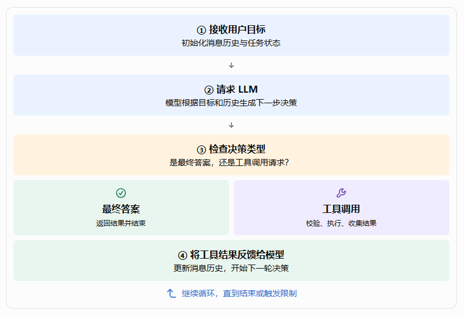
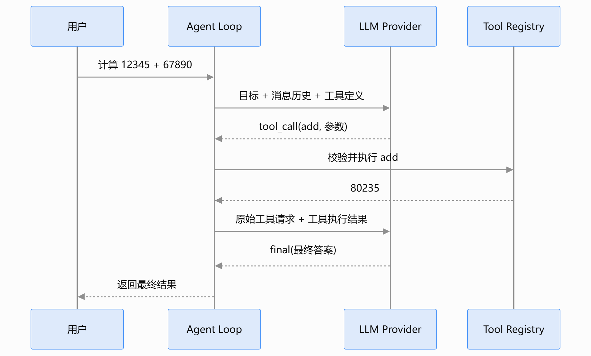

亲手实现第一个 Agent——从模型调用到 Agent Loop。

这一篇进一步回答一个工程问题：

**如何使用 Python 3，从零开始编写一个真正调用 LLM API、能够执行工具、接收工具结果、继续请求模型，并且知道何时停止的 Agent？**

本篇为实战教程。

## 一、先确定本篇的学习目标

完成后，读者不只是理解 Agent 的概念，而是能够运行一个具有以下行为的程序：

1. 接收用户提出的任务。
2. 请求真实 LLM 判断下一步应该做什么。
3. 根据模型的结构化决策，调用经过注册的工具。
4. 将工具执行结果反馈给模型。
5. 让模型根据真实结果决定继续行动还是返回答案。
6. 在任务完成、执行失败或达到最大步数时，合理结束运行。

这里有一个重要的教学原则：先实现一个最小但真实的 Agent，再逐步增加工程能力，而不是一开始就引入完整的 Agent 框架。

## 二、设计整个实战项目

我们不直接从几十行代码开始，而是先确定系统结构，避免后面随着功能增加，不断推翻已有实现。

### 2.1 本篇采用的技术栈

| 技术          | 用途                               |
| ------------- | ---------------------------------- |
| Python 3.11+  | Agent 核心实现语言                 |
| OpenAI SDK    | 调用 OpenAI 及兼容其接口的模型服务 |
| Anthropic SDK | 调用 Claude 模型                   |
| Pydantic      | 定义和校验结构化决策结果           |
| pytest        | 自动化测试                         |
| python-dotenv | 加载环境变量与本地开发配置         |

为了让示例更容易理解，我们暂时不引入 LangGraph、LangChain 或其他完整 Agent 框架。我们自己实现模型适配器、工具执行器和 Agent Loop，理解每个组件到底在做什么。

需要注意：DeepSeek 和 Ollama 的具体接入方式取决于服务版本、接口协议和所用模型。OpenAI 兼容接口可以复用同一适配器，但 Anthropic 使用自己的消息与工具调用协议，因此需要单独的适配器。

### 2.2 项目目录

建议创建一个名为 `first-agent` 的项目。


这个结构刻意保持简单，但已经体现了几个重要的架构边界：

- `models.py` 不负责执行工具。
- `tools.py` 不负责决定下一步行动。
- `agent.py` 不需要了解不同模型供应商的底层响应格式。
- `decision.py` 定义各组件之间交换的数据结构。

这意味着后面即使更换模型、增加工具或者改进执行循环，也不必把所有代码一起修改。

各模块的依赖关系如下：

```text
main.py
  |
  +---- model_factory.py
  |          |
  |          v
  |       models.py
  |
  +---- tools.py
  |
  v
agent.py
  |
  +---- models.py
  +---- decision.py
  +---- tools.py

tests/test_agent.py
  |
  +---- agent.py
  +---- decision.py
  +---- tools.py
```


## 三、第一步：搭建 Python 开发环境

### 3.1 创建项目和虚拟环境

在终端执行：

```bash
mkdir first-agent
cd first-agent

python -m venv .venv
```

激活虚拟环境。

- Windows PowerShell：

```powershell
.venv\Scripts\Activate.ps1
```

- macOS 或 Linux：

```bash
source .venv/bin/activate
```

安装依赖：

```bash
pip install openai anthropic pydantic python-dotenv pytest
```

也可以将依赖记录到 `requirements.txt`：

```text
openai
anthropic
pydantic
python-dotenv
pytest
```

后续团队协作时，建议使用锁定版本的依赖文件，避免不同环境安装到不兼容的 SDK 版本。

### 3.2 配置模型服务

在项目根目录创建 `.env`：

```text
MODEL_PROVIDER=deepseek
MODEL_NAME=deepseek-chat

OPENAI_API_KEY=
OPENAI_BASE_URL=

ANTHROPIC_API_KEY=

DEEPSEEK_API_KEY=
DEEPSEEK_BASE_URL=https://api.deepseek.com

OLLAMA_BASE_URL=http://localhost:11434/v1
```

以上是配置模板。实际使用时，只需要填写计划调用的服务所需的密钥和地址。

几个配置说明：

- OpenAI：填写 `OPENAI_API_KEY`，使用服务默认地址。
- DeepSeek：填写 `DEEPSEEK_API_KEY` 和对应的 API 地址。
- Ollama：先在本地安装并启动 Ollama，再下载一个适合本机运行的模型。
- Anthropic：填写 `ANTHROPIC_API_KEY`，通过 Anthropic SDK 调用。

`.env` 需要加入 `.gitignore`，不能提交真实 API Key。生产环境应该使用密钥管理服务，而不是把密钥写进代码或配置仓库。

## 四、第二步：定义统一的模型调用接口

这一部分是整个实战项目最重要的架构设计之一。

### 4.1 为什么需要统一模型接口？

假设我们直接在 Agent 中调用 OpenAI：

```python
response = client.chat.completions.create(...)
```

当我们需要切换到 Anthropic 时，可能就得改写调用逻辑：

```python
response = anthropic_client.messages.create(...)
```

不同供应商在以下方面可能存在差异：

- 请求参数和消息格式。
- 工具定义和工具调用结果格式。
- 模型名称及配置参数。
- 错误类型、限流和超时行为。
- 支持的多模态能力和结构化输出能力。

如果这些差异直接散落在 Agent Loop 中，模型越多，代码越难维护。

更合理的方式是引入 Model Adapter（模型适配器）。


### 4.2 先定义模型的统一决策结构

Agent 需要知道模型想做什么，而不应该直接依赖某个 SDK 的原始响应对象。

因此，我们先规定模型可能产生两类决策：

1. `final`：任务已经可以返回最终答案。
2. `tool_call`：需要调用一个或多个工具。

创建 `app/decision.py`：

```python
from typing import Any, Literal
from pydantic import BaseModel, Field


class ToolCall(BaseModel):
    id: str
    name: str
    arguments: dict[str, Any] = Field(default_factory=dict)


class Decision(BaseModel):
    type: Literal["final", "tool_call"]
    content: str = ""
    tool_calls: list[ToolCall] = Field(default_factory=list)
```

这里为什么使用 Pydantic？

因为模型的输出可能不符合预期。我们需要一个明确的数据结构，避免 Agent 在执行过程中遇到字段缺失、类型不正确等问题。

例如，最终答案可以表示为：

```python
Decision(
    type="final",
    content="12 + 30 = 42"
)
```

工具调用可以表示为：

```python
Decision(
    type="tool_call",
    tool_calls=[
        ToolCall(
            id="call_001",
            name="add",
            arguments={"a": 12, "b": 30}
        )
    ]
)
```

⚠️注意：这里的 `Decision` 是我们自己设计的内部协议，并不是 OpenAI 或 Anthropic 官方规定的数据结构。

### 4.3 定义统一的模型接口

创建 `app/models.py`：

```python
from abc import ABC, abstractmethod
from typing import Any

from .decision import Decision


class ModelClient(ABC):
    @abstractmethod
    def decide(
        self,
        messages: list[dict[str, Any]],
        tools: list[dict[str, Any]],
    ) -> Decision:
        """根据消息和工具定义，返回统一决策。"""
        raise NotImplementedError
```

这段代码定义了一个抽象接口。

任何模型适配器，只要实现 `decide()` 方法，就可以接入 Agent。

例如：

```text
OpenAIAdapter.decide()
DeepSeekAdapter.decide()
OllamaAdapter.decide()
AnthropicAdapter.decide()
```

它们的内部实现可以完全不同，但 Agent 使用它们的方式保持一致。

这就是面向接口编程的价值：**上层依赖稳定的抽象，下层负责适配不同的外部实现**。

## 五、第三步：接入真实 LLM Provider

现在，我们让统一接口真正连接模型，而不是使用模拟模型。

### 5.1 实现 OpenAI 兼容接口适配器

OpenAI 兼容接口的价值在于，很多模型服务可以通过相近的请求格式访问。但兼容程度并不完全一致，特别是工具调用、多模态输入和结构化输出，仍然需要实际验证。

先约定内部消息协议：

```python
# 用户消息
{"role": "user", "content": "计算 12 + 30"}

# 助手请求工具
{
    "role": "assistant",
    "tool_calls": [
        {
            "id": "call_001",
            "name": "add",
            "arguments": {"a": 12, "b": 30}
        }
    ]
}

# 工具执行结果
{
    "role": "tool",
    "tool_call_id": "call_001",
    "content": "42"
}
```

内部协议与供应商原始协议分离，后续切换模型时，Agent 不需要跟着改变。

在 `app/models.py` 中继续增加 OpenAICompatibleAdapter 适配器代码和导入包代码，完整代码如下：

```python
import json
import os

from openai import OpenAI

from abc import ABC, abstractmethod
from typing import Any

from .decision import Decision, ToolCall


class ModelClient(ABC):
    @abstractmethod
    def decide(
        self,
        messages: list[dict[str, Any]],
        tools: list[dict[str, Any]],
    ) -> Decision:
        """根据消息和工具定义，返回统一决策。"""
        raise NotImplementedError

class OpenAICompatibleAdapter(ModelClient):
    def __init__(
        self,
        model: str,
        api_key: str | None = None,
        base_url: str | None = None,
    ):
        self.model = model
        self.client = OpenAI(
            api_key=api_key or os.getenv("OPENAI_API_KEY") or "ollama",
            base_url=base_url or None,
            timeout=60.0,
            max_retries=0,
        )

    def decide(self, messages, tools) -> Decision:
        response = self.client.chat.completions.create(
            model=self.model,
            messages=messages,
            tools=tools or None,
            temperature=0,
        )

        message = response.choices[0].message

        if message.tool_calls:
            calls = []

            for call in message.tool_calls:
                calls.append(
                    ToolCall(
                        id=call.id,
                        name=call.function.name,
                        arguments=json.loads(
                            call.function.arguments or "{}"
                        ),
                    )
                )

            return Decision(
                type="tool_call",
                tool_calls=calls,
            )

        return Decision(
            type="final",
            content=message.content or "",
        )
```

这里有三个需要理解的地方。

- 第一，模型适配器负责协议转换。 它读取 SDK 返回的响应，提取工具调用或最终答案，再转换成统一的 `Decision`。

- 第二，模型调用不等于工具执行。 上面的代码只读取模型提出的调用请求，还没有执行任何工具。

- 第三，不能无限重试。 示例关闭了 SDK 内置的自动重试，目的是让本篇后续可以清楚地观察失败行为。生产系统可以增加有上限的指数退避重试，并针对限流、网络错误和不可重试错误分别处理。

OpenAI、DeepSeek 和 Ollama 可以通过该适配器接入，但需要分别配置模型名称、API Key 和服务地址。

### 5.2 接入 Anthropic Claude

Anthropic 使用自己的消息和工具调用协议。不能简单地把 `OpenAICompatibleAdapter` 的请求地址换成 Anthropic 地址就认为完成了适配。

下面给出一个教学版 Anthropic 适配器。它将前面定义的内部消息协议转换为 Anthropic Messages API 的请求格式。

继续在 `app/models.py` 中添加适配 Anthropic 大模型的代码，加入后 models.py 的完整代码如下：

```python
import json
import os

from openai import OpenAI
from anthropic import Anthropic

from abc import ABC, abstractmethod
from typing import Any

from .decision import Decision, ToolCall


class ModelClient(ABC):
    @abstractmethod
    def decide(
        self,
        messages: list[dict[str, Any]],
        tools: list[dict[str, Any]],
    ) -> Decision:
        """根据消息和工具定义，返回统一决策。"""
        raise NotImplementedError

class OpenAICompatibleAdapter(ModelClient):
    def __init__(
        self,
        model: str,
        api_key: str | None = None,
        base_url: str | None = None,
    ):
        self.model = model
        self.client = OpenAI(
            api_key=api_key or os.getenv("OPENAI_API_KEY") or "ollama",
            base_url=base_url or None,
            timeout=60.0,
            max_retries=0,
        )

    def decide(self, messages, tools) -> Decision:
        response = self.client.chat.completions.create(
            model=self.model,
            messages=messages,
            tools=tools or None,
            temperature=0,
        )

        message = response.choices[0].message

        if message.tool_calls:
            calls = []

            for call in message.tool_calls:
                calls.append(
                    ToolCall(
                        id=call.id,
                        name=call.function.name,
                        arguments=json.loads(
                            call.function.arguments or "{}"
                        ),
                    )
                )

            return Decision(
                type="tool_call",
                tool_calls=calls,
            )

        return Decision(
            type="final",
            content=message.content or "",
        )

class AnthropicAdapter(ModelClient):
    def __init__(self, model: str):
        self.model = model
        self.client = Anthropic(
            api_key=os.environ["ANTHROPIC_API_KEY"],
            timeout=60.0,
            max_retries=0,
        )

    def decide(self, messages, tools) -> Decision:
        system_parts = []
        conversation = []

        for message in messages:
            role = message["role"]

            if role == "system":
                system_parts.append(message["content"])

            elif role == "user":
                conversation.append({
                    "role": "user",
                    "content": message["content"],
                })

            elif role == "assistant":
                blocks = []

                if message.get("content"):
                    blocks.append({
                        "type": "text",
                        "text": message["content"],
                    })

                for call in message.get("tool_calls", []):
                    blocks.append({
                        "type": "tool_use",
                        "id": call["id"],
                        "name": call["name"],
                        "input": call["arguments"],
                    })

                conversation.append({
                    "role": "assistant",
                    "content": blocks or [{
                        "type": "text",
                        "text": "",
                    }],
                })

            elif role == "tool":
                conversation.append({
                    "role": "user",
                    "content": [{
                        "type": "tool_result",
                        "tool_use_id": message["tool_call_id"],
                        "content": message["content"],
                        "is_error": message.get("is_error", False),
                    }],
                })

        anthropic_tools = [
            {
                "name": tool["function"]["name"],
                "description": tool["function"]["description"],
                "input_schema": tool["function"]["parameters"],
            }
            for tool in tools
        ]

        response = self.client.messages.create(
            model=self.model,
            max_tokens=2048,
            system="\n\n".join(system_parts),
            messages=conversation,
            tools=anthropic_tools or [],
        )

        calls = []
        texts = []

        for block in response.content:
            if block.type == "tool_use":
                calls.append(
                    ToolCall(
                        id=block.id,
                        name=block.name,
                        arguments=block.input,
                    )
                )
            elif block.type == "text":
                texts.append(block.text)

        if calls:
            return Decision(
                type="tool_call",
                tool_calls=calls,
            )

        if response.stop_reason == "max_tokens":
            raise RuntimeError("模型输出达到 token 上限，答案可能不完整")

        return Decision(
            type="final",
            content="\n".join(texts),
        )
```


j加入的 AnthropicAdapter 这段代码展示了跨 Provider 适配的核心思想，但属于教学版实现：它主要处理本文定义的文本消息和工具调用协议。生产系统还需要严格处理消息交替规则、连续工具结果、空内容、结构化输出、供应商特有的错误与结束原因，以及模型能力差异。

另外，OpenAI SDK 与 Anthropic SDK 的具体字段、参数和支持能力可能随 SDK 版本变化。实际项目应固定依赖版本，并针对选用的模型运行集成测试。

### 5.3 创建模型工厂：选择当前使用的模型

模型工厂负责读取环境变量，并创建对应的模型适配器。

创建 `app/model_factory.py`：

```python
import os

from dotenv import load_dotenv

from .models import (
    AnthropicAdapter,
    OpenAICompatibleAdapter,
)

load_dotenv()


def create_model():
    provider = os.getenv(
        "MODEL_PROVIDER", "deepseek"
    ).lower()

    model = os.getenv("MODEL_NAME", "")

    if provider == "openai":
        return OpenAICompatibleAdapter(
            model=model or "gpt-4.1-mini",
            api_key=os.environ["OPENAI_API_KEY"],
        )

    if provider == "deepseek":
        return OpenAICompatibleAdapter(
            model=model or "deepseek-chat",
            api_key=os.environ["DEEPSEEK_API_KEY"],
            base_url=os.getenv(
                "DEEPSEEK_BASE_URL",
                "https://api.deepseek.com",
            ),
        )

    if provider == "ollama":
        return OpenAICompatibleAdapter(
            model=model,
            api_key="ollama",
            base_url=os.getenv(
                "OLLAMA_BASE_URL",
                "http://localhost:11434/v1",
            ),
        )

    if provider == "anthropic":
        return AnthropicAdapter(
            model=model or "claude-sonnet-4-5"
        )

    raise ValueError(f"不支持的模型供应商: {provider}")
```

这里的模型名称只是配置示例，不保证所有账户、地区或本地服务都能使用该模型。实际运行时应选择当前服务支持的模型，并根据官方文档核对名称。

切换供应商时，可以修改 `.env`：

```text
MODEL_PROVIDER=deepseek
MODEL_NAME=deepseek-chat
```

或者：

```text
MODEL_PROVIDER=ollama
MODEL_NAME=qwen3
```

也可以配置为：

```text
MODEL_PROVIDER=anthropic
MODEL_NAME=claude-sonnet-4-5
```

无需修改 Agent Loop 本身。

## 六、第四步：构建工具注册与执行系统

模型现在已经能够返回决策，但如果没有工具，Agent 仍然只能回答问题。

我们先实现两个简单工具：

- `add`：执行精确的加法计算。
- `get_current_date`：读取运行环境的当前日期。

这里使用本地确定性函数，方便测试，也能避免初学阶段依赖额外的搜索或天气服务。

### 6.1 定义工具注册表

创建 `app/tools.py`：

```python
from datetime import date
from typing import Any, Callable

from pydantic import BaseModel, ConfigDict, Field


class AddArgs(BaseModel):
    model_config = ConfigDict(extra="forbid")

    a: int = Field(description="第一个整数")
    b: int = Field(description="第二个整数")


class DateArgs(BaseModel):
    model_config = ConfigDict(extra="forbid")


def add(a: int, b: int) -> int:
    return a + b


def get_current_date() -> str:
    return date.today().isoformat()


class Tool:
    def __init__(
        self,
        name: str,
        description: str,
        args_model: type[BaseModel],
        function: Callable[..., Any],
    ):
        self.name = name
        self.description = description
        self.args_model = args_model
        self.function = function

    def execute(self, arguments: dict[str, Any]) -> Any:
        # 在执行前验证参数
        args = self.args_model.model_validate(arguments)

        # 只调用经过注册的函数
        return self.function(**args.model_dump())


class ToolRegistry:
    def __init__(self):
        self._tools: dict[str, Tool] = {}

    def register(self, tool: Tool):
        if tool.name in self._tools:
            raise ValueError(f"工具重复注册: {tool.name}")

        self._tools[tool.name] = tool

    def get(self, name: str) -> Tool:
        if name not in self._tools:
            raise ValueError(f"未知工具: {name}")

        return self._tools[name]

    def definitions(self) -> list[dict]:
        result = []

        for tool in self._tools.values():
            schema = tool.args_model.model_json_schema()

            result.append({
                "type": "function",
                "function": {
                    "name": tool.name,
                    "description": tool.description,
                    "parameters": schema,
                },
            })

        return result


def build_registry() -> ToolRegistry:
    registry = ToolRegistry()

    registry.register(
        Tool(
            name="add",
            description="计算两个整数的和",
            args_model=AddArgs,
            function=add,
        )
    )

    registry.register(
        Tool(
            name="get_current_date",
            description="获取运行环境当前日期",
            args_model=DateArgs,
            function=get_current_date,
        )
    )

    return registry
```

工具调用过程分为两个阶段：

- `definitions()`：向模型提供工具名称、描述与参数 Schema。
- `execute()`：在运行时重新校验参数，然后执行已注册的函数。

模型返回的参数不应被直接信任。Schema 校验是必要的输入检查，但如果工具具有文件、网络或其他副作用，还需要增加权限与安全策略。

### 6.2 为什么工具需要 Schema？

工具不能只是一组随意命名的 Python 函数。

Agent 至少需要知道：

- 工具名称是什么。
- 工具可以做什么。
- 调用时需要哪些参数。
- 参数的类型和约束是什么。
- 如何验证调用请求。

例如，`add` 工具的参数 Schema 会告诉模型，它需要提供两个整数参数 `a` 和 `b`。

这里有两种校验：

1. 模型侧的工具描述：帮助模型生成正确的参数。
2. 执行侧的 Pydantic 校验：在真正调用函数前检查参数。

前者不能替代后者。即使模型生成了错误参数，运行时也必须拒绝无效输入。

工具描述也不等于权限控制。后续进入企业级开发时，还要为工具增加权限、超时、审计、执行环境与人工审批机制。

## 七、第五步：实现真正的 Agent Loop

现在，我们已经有了三项基础能力：

- 统一的模型调用接口。
- 统一的决策结果结构。
- 可以注册、发现和执行的工具。

接下来，将这些组件连接起来，形成 Agent 的执行循环。

### 7.1 先明确 Agent Loop 的执行过程

如下图：



这里有一个实现细节：不同模型 API 对工具调用的消息格式有不同要求。因此，我们需要在模型适配器中完成消息转换，不能直接把自定义的内部消息结构原样发送给所有供应商。

### 7.2 完善 OpenAI 兼容适配器的消息转换

为了使前面的示例形成一致的内部协议，需要在 `app/models.py` 中增加以下转换函数：

```python
import json
from typing import Any


def to_openai_messages(
    messages: list[dict[str, Any]],
) -> list[dict[str, Any]]:
    result = []

    for message in messages:
        role = message["role"]

        if role in ("system", "user"):
            result.append({
                "role": role,
                "content": message["content"],
            })

        elif role == "assistant":
            item = {
                "role": "assistant",
                "content": message.get("content") or None,
            }

            calls = message.get("tool_calls", [])

            if calls:
                item["tool_calls"] = [
                    {
                        "id": call["id"],
                        "type": "function",
                        "function": {
                            "name": call["name"],
                            "arguments": json.dumps(
                                call["arguments"],
                                ensure_ascii=False,
                            ),
                        },
                    }
                    for call in calls
                ]

            result.append(item)

        elif role == "tool":
            result.append({
                "role": "tool",
                "tool_call_id": message["tool_call_id"],
                "content": message["content"],
            })

        else:
            raise ValueError(f"不支持的消息角色: {role}")

    return result
```

然后，在 `OpenAICompatibleAdapter.decide()` 中，把原先的：

```python
messages=messages
```

替换为：

```python
messages=to_openai_messages(messages)
```

这样，Agent 内部使用统一消息格式，而 OpenAI 兼容接口收到的是它所需的消息格式。

这一步很重要：统一模型接口不仅仅是统一方法名称，还需要统一消息、决策和工具结果的表达方式。

### 7.3 编写 Agent 执行循环

创建 `app/agent.py`：

```python
import json
import logging
from typing import Any

from .decision import Decision
from .models import ModelClient
from .tools import ToolRegistry

logger = logging.getLogger("first_agent")


class AgentError(Exception):
    pass


class AgentMaxStepsExceeded(AgentError):
    pass


class Agent:
    def __init__(
        self,
        model: ModelClient,
        tools: ToolRegistry,
        max_steps: int = 8,
    ):
        if max_steps < 1:
            raise ValueError("max_steps 必须大于 0")

        self.model = model
        self.tools = tools
        self.max_steps = max_steps

    def run(self, user_input: str) -> str:
        messages: list[dict[str, Any]] = [
            {
                "role": "system",
                "content": (
                    "你是一个能够使用工具的助手。"
                    "需要精确计算时，请使用提供的工具。"
                    "必须根据工具的真实返回值回答，"
                    "不要声称执行了实际上没有执行的操作。"
                ),
            },
            {
                "role": "user",
                "content": user_input,
            },
        ]

        for step in range(1, self.max_steps + 1):
            logger.info("Step %s: 请求模型决策", step)

            decision = self.model.decide(
                messages=messages,
                tools=self.tools.definitions(),
            )

            logger.info(
                "Step %s: 决策类型=%s",
                step,
                decision.type,
            )

            if decision.type == "final":
                if decision.tool_calls:
                    raise AgentError(
                        "最终决策不能同时包含工具调用"
                    )

                logger.info("任务完成")
                return decision.content

            if decision.type != "tool_call":
                raise AgentError(
                    f"未知决策类型: {decision.type}"
                )

            if not decision.tool_calls:
                raise AgentError(
                    "工具调用决策没有包含工具请求"
                )

            # 保存助手发出的工具调用请求
            messages.append({
                "role": "assistant",
                "content": decision.content,
                "tool_calls": [
                    {
                        "id": call.id,
                        "name": call.name,
                        "arguments": call.arguments,
                    }
                    for call in decision.tool_calls
                ],
            })

            for call in decision.tool_calls:
                logger.info(
                    "执行工具: %s, 参数=%s",
                    call.name,
                    call.arguments,
                )

                try:
                    tool = self.tools.get(call.name)
                    result = tool.execute(call.arguments)

                    tool_message = {
                        "role": "tool",
                        "tool_call_id": call.id,
                        "content": json.dumps(
                            result,
                            ensure_ascii=False,
                        ),
                    }

                    logger.info(
                        "工具 %s 执行成功",
                        call.name,
                    )

                except Exception as exc:
                    # 将工具错误作为观察结果反馈给模型。
                    # 注意：记录完整异常到服务端日志；
                    # 不向模型暴露密钥、堆栈或内部敏感信息。
                    logger.exception(
                        "工具 %s 执行失败",
                        call.name,
                    )

                    tool_message = {
                        "role": "tool",
                        "tool_call_id": call.id,
                        "content": json.dumps(
                            {
                                "error": type(exc).__name__,
                                "message": "工具执行失败，请根据错误调整操作。",
                            },
                            ensure_ascii=False,
                        ),
                        "is_error": True,
                    }

                messages.append(tool_message)

        raise AgentMaxStepsExceeded(
            f"Agent 达到最大执行步数: {self.max_steps}"
        )
```

这段代码就是本篇的核心。

它将之前分离的模块组织成一个完整的执行系统：

- `ModelClient` 负责提供下一步决策。
- `Decision` 负责表达决策结果。
- `ToolRegistry` 负责发现工具和执行工具。
- `Agent.run()` 负责协调模型、工具与消息历史。
- `max_steps` 负责限制执行循环。
- 日志负责记录每一步的运行情况。

**如何避免 Agent 无限运行？**

上面函数里有一个 `max_steps` 负责限制执行循环。如果模型持续请求工具，或者无法判断任务何时完成，程序就可能不断调用模型，产生不必要的成本和延迟。因此，Agent Loop 必须有明确的控制机制。最简单的限制方式是设置最大执行步数 max_steps。


这里需要说明一个边界：示例会把普通工具执行异常反馈给模型，让模型有机会调整行动，但不会自动重试模型 API 调用。对于模型超时、服务限流等问题，应由单独的模型调用策略处理，而不能简单地把所有错误都当作工具失败。

另外，这还是一个教学级 Agent，不是完整的生产实现。它尚未实现任务取消、整体执行超时、人工审批、并行工具执行、持久化任务状态，以及跨请求的重试预算。后续课程可以逐步补齐。

## 八、第六步：运行你的第一个真实 Agent

### 8.1 创建程序入口

创建 `main.py`：

```python
import logging

from app.agent import Agent
from app.model_factory import create_model
from app.tools import build_registry


logging.basicConfig(
    level=logging.INFO,
    format="%(asctime)s [%(levelname)s] %(message)s",
)


def main():
    model = create_model()
    tools = build_registry()

    agent = Agent(
        model=model,
        tools=tools,
        max_steps=8,
    )

    answer = agent.run(
        "请使用计算工具计算 12345 + 67890，"
        "并解释计算结果。"
    )

    print("\n最终答案：")
    print(answer)


if __name__ == "__main__":
    main()
```

运行：

```bash
python main.py
```

如果模型服务、API Key 和模型名称配置正确，你应该能够观察到类似的运行过程：

```text
[INFO] Step 1: 请求模型决策
[INFO] Step 1: 决策类型=tool_call
[INFO] 执行工具: add, 参数={'a': 12345, 'b': 67890}
[INFO] 工具 add 执行成功

[INFO] Step 2: 请求模型决策
[INFO] Step 2: 决策类型=final
[INFO] 任务完成

最终答案：
12345 + 67890 = 80235
```

这只是示意日志，不是某个真实模型已经运行的结果。实际步数、模型输出内容和日志格式会因模型及 SDK 而异。

### 8.2 观察一次工具调用的完整时序



这个时序图揭示了一个关键机制：

模型不是直接执行 Python 函数，而是提出工具调用请求；Agent Runtime 负责真正执行，并把执行结果反馈给模型。

当模型发现工具结果不足以完成任务时，它可以继续请求其他工具。循环的控制权始终由 Agent 运行时掌握。

## 九、第七步：编写测试，验证 Agent 的行为

真实模型调用存在网络延迟、费用、限流和非确定性。如果每次运行测试都调用真实 API，就会让测试变慢、变贵，而且难以稳定复现问题。

因此，我们应该区分两种测试：

- 单元测试：使用模拟模型，验证 Agent Loop、工具执行和停止条件。
- 集成测试：调用真实模型，验证 Provider 适配器、工具协议和实际模型行为。

先从单元测试开始。

### 9.1 创建一个可预测的模拟模型

测试不应依赖真实 API。我们通过 `FakeModel` 预先定义模型的决策序列，验证 Agent 是否按预期执行。

在 `tests/test_agent.py` 中编写：

```python
from app.agent import Agent, AgentMaxStepsExceeded
from app.decision import Decision, ToolCall
from app.tools import build_registry


class FakeModel:
    def __init__(self, decisions):
        self.decisions = iter(decisions)
        self.calls = 0

    def decide(self, messages, tools):
        self.calls += 1
        return next(self.decisions)


def test_agent_calls_tool_and_finishes():
    model = FakeModel([
        Decision(
            type="tool_call",
            tool_calls=[
                ToolCall(
                    id="call_1",
                    name="add",
                    arguments={"a": 12, "b": 30},
                )
            ],
        ),
        Decision(
            type="final",
            content="12 + 30 = 42",
        ),
    ])

    agent = Agent(
        model=model,
        tools=build_registry(),
        max_steps=5,
    )

    answer = agent.run("计算 12 + 30")

    assert answer == "12 + 30 = 42"
    assert model.calls == 2


def test_agent_stops_at_max_steps():
    model = FakeModel([
        Decision(
            type="tool_call",
            tool_calls=[
                ToolCall(
                    id=f"call_{i}",
                    name="add",
                    arguments={"a": 1, "b": 2},
                )
            ],
        )
        for i in range(10)
    ])

    agent = Agent(
        model=model,
        tools=build_registry(),
        max_steps=2,
    )

    try:
        agent.run("计算 1 + 2")
        assert False, "应该触发最大执行步数异常"
    except AgentMaxStepsExceeded:
        pass

    assert model.calls == 2


def test_unknown_tool_does_not_execute():
    model = FakeModel([
        Decision(
            type="tool_call",
            tool_calls=[
                ToolCall(
                    id="call_unknown",
                    name="delete_everything",
                    arguments={},
                )
            ],
        ),
        Decision(
            type="final",
            content="未知工具无法执行。",
        ),
    ])

    agent = Agent(
        model=model,
        tools=build_registry(),
        max_steps=5,
    )

    answer = agent.run("删除所有文件")

    assert answer == "未知工具无法执行。"
```

在 `app/__init__.py` 和 `tests/__init__.py` 中可以暂时不写任何代码，保留空文件即可。

运行测试：

```ba
pytest -v
```

预期这三个测试都会通过。

最后一个测试尤其值得注意：模型提出了一个没有注册的工具，系统没有执行任意代码，而是记录工具失败，并将安全的错误结果交给模型。模型随后返回最终答案。

在实际项目中，未知工具应当被明确拒绝。是否继续任务，可以由 Agent 策略决定；对于具有破坏性的操作，仅仅返回错误并不构成完整的安全治理。

## 十、第八步：对比单轮 LLM 与多步 Agent

完成代码后，我们需要回到最初的问题：为什么不能只调用一次 LLM？

### 10.1 单轮 LLM 的工作方式

单轮 LLM 应用的核心流程是：

```python
def ask_llm(model, question):
    decision = model.decide(
        messages=[
            {"role": "user", "content": question}
        ],
        tools=[],
    )

    return decision.content
```

这个例子展示的是没有工具的单次模型请求。实际使用时，模型适配器需要按照相应 Provider 的接口发送请求。

如果用户提出：

> 计算 12345 + 67890，并解释结果。

模型可能直接生成答案。但如果它没有使用计算工具，结果就依赖模型自身的计算表现，而不是程序执行的精确计算。

单轮调用适合：

- 普通问答。
- 文本改写与摘要。
- 简单内容生成。
- 不需要外部执行的任务。

### 10.2 多步 Agent 的工作方式

多步 Agent 会先将工具定义提供给模型，让模型自行判断是否需要调用工具。

```text
用户提出任务
    ↓
LLM 决定调用 add
    ↓
Agent 执行 add(12345, 67890)
    ↓
工具返回 80235
    ↓
Agent 将结果反馈给 LLM
    ↓
LLM 解释计算结果
    ↓
返回最终答案
```

这里的核心价值不是简单地多调用几次模型，而是让模型的后续决策能够依据程序实际执行得到的结果。

### 10.3 两种方式的对比

| 对比维度       | 单轮 LLM             | 多步 Agent                         |
| -------------- | -------------------- | ---------------------------------- |
| 模型调用次数   | 通常一次             | 一次或多次                         |
| 工具执行       | 通常没有             | 可以执行注册工具                   |
| 真实结果反馈   | 依赖输入上下文       | 可将工具结果加入上下文             |
| 动态调整       | 主要在单次生成中完成 | 可以根据每一步的结果继续调整       |
| 运行时复杂度   | 较低                 | 较高                               |
| 执行成本与延迟 | 通常较低             | 通常较高                           |
| 错误处理       | 主要处理单次请求     | 还要处理工具失败与循环控制         |
| 适用场景       | 简单生成和问答       | 需要外部行动、反馈或动态决策的任务 |

需要强调的是，多步 Agent 并不天然比单轮 LLM 更准确。如果任务很简单，额外的工具调用和模型推理反而会增加延迟、成本与故障机会。

只有当任务确实需要外部操作、获取实时或确定性数据、根据反馈调整行动时，多步 Agent 的机制才有明显价值。

## 十一、从能运行到可靠：本篇还需要建立哪些工程意识？

到这里，我们已经完成了第一个真实模型驱动的 Agent 的基本骨架。但如果希望这份代码成为后续企业级 Agent 开发的基础，还需要明确几个工程边界。

### 11.1 Agent Loop 不是无限循环

最大执行步数只是第一道保护措施。

一个实际运行的 Agent 还需要限制：

- 模型调用总次数和 Token 消耗。
- 整体任务执行时间与单次工具超时。
- 连续失败次数与重试次数。
- 重复工具调用与无效循环。
- 用户取消和任务中断。
- 需要人工批准的高风险操作。

例如，模型持续请求相同工具、传入相同参数时，即使每次工具执行都成功，也可能无法推进任务。因此，后续可以在 Agent Loop 中增加重复调用检测和任务进度判断。

### 11.2 工具执行与模型决策应该分离

不要把工具函数直接写进提示词，也不要让模型生成任意 Python 代码后直接执行。

更合理的执行链路是：

```text
LLM 生成调用请求
        ↓
检查工具是否注册
        ↓
校验参数 Schema
        ↓
检查权限与执行策略
        ↓
调用真实工具
        ↓
记录执行结果与审计事件
        ↓
反馈给 LLM
```

随着工具数量增加，这条链路可以逐步发展成统一的 Tool Registry、Tool Executor 和权限治理系统。

### 11.3 统一模型接口需要明确能力边界

虽然我们通过 `ModelClient` 统一了不同 Provider 的调用入口，但不同模型并不具有完全相同的能力。

后续可以给模型适配器增加能力描述，例如：

```python
class ModelCapabilities:
    tool_calling: bool
    structured_output: bool
    vision: bool
    streaming: bool
```

实际实现时，可以使用 Pydantic 或 `dataclass` 定义字段及默认值。

模型路由器便可以根据任务需要选择合适的模型，而不是仅仅根据供应商名称切换接口。

还需要注意：

统一决策结构也应随着需求演进。例如，支持并行工具调用、多模态内容、模型拒绝、输出不完整等情况时，需要扩展决策协议和消息适配器。
