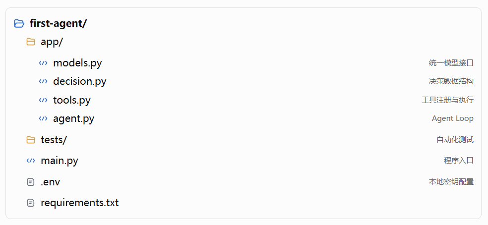
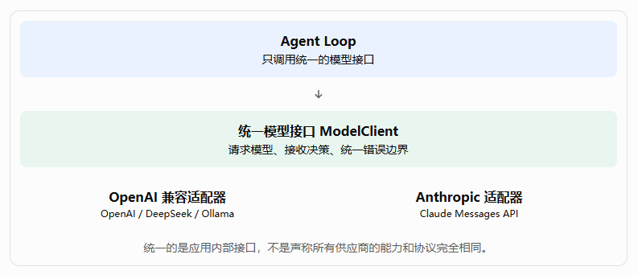

亲手实现第一个 Agent——从模型调用到 Agent Loop。

这一篇进一步回答一个工程问题：

**如何使用 Python 3，从零开始编写一个真正调用 LLM API、能够执行工具、接收工具结果、继续请求模型，并且知道何时停止的 Agent？**

本篇为实战教程。

## 一、先确定本篇的学习目标

完成后，读者不只是理解 Agent 的概念，而是能够运行一个具有以下行为的程序：

1. 接收用户提出的任务。
2. 请求真实 LLM 判断下一步应该做什么。
3. 根据模型的结构化决策，调用经过注册的工具。
4. 将工具执行结果反馈给模型。
5. 让模型根据真实结果决定继续行动还是返回答案。
6. 在任务完成、执行失败或达到最大步数时，合理结束运行。

这里有一个重要的教学原则：先实现一个最小但真实的 Agent，再逐步增加工程能力，而不是一开始就引入完整的 Agent 框架。

## 二、设计整个实战项目

我们不直接从几十行代码开始，而是先确定系统结构，避免后面随着功能增加，不断推翻已有实现。

### 2.1 本篇采用的技术栈

| 技术          | 用途                               |
| ------------- | ---------------------------------- |
| Python 3.11+  | Agent 核心实现语言                 |
| OpenAI SDK    | 调用 OpenAI 及兼容其接口的模型服务 |
| Anthropic SDK | 调用 Claude 模型                   |
| Pydantic      | 定义和校验结构化决策结果           |
| pytest        | 自动化测试                         |
| python-dotenv | 加载环境变量与本地开发配置         |

为了让示例更容易理解，我们暂时不引入 LangGraph、LangChain 或其他完整 Agent 框架。我们自己实现模型适配器、工具执行器和 Agent Loop，理解每个组件到底在做什么。

需要注意：DeepSeek 和 Ollama 的具体接入方式取决于服务版本、接口协议和所用模型。OpenAI 兼容接口可以复用同一适配器，但 Anthropic 使用自己的消息与工具调用协议，因此需要单独的适配器。

### 2.2 项目目录

建议创建一个名为 `first-agent` 的项目。



这个结构刻意保持简单，但已经体现了几个重要的架构边界：

- `models.py` 不负责执行工具。
- `tools.py` 不负责决定下一步行动。
- `agent.py` 不需要了解不同模型供应商的底层响应格式。
- `decision.py` 定义各组件之间交换的数据结构。

这意味着后面即使更换模型、增加工具或者改进执行循环，也不必把所有代码一起修改。

## 三、第一步：搭建 Python 开发环境

### 3.1 创建项目和虚拟环境

在终端执行：

```bash
mkdir first-agent
cd first-agent

python -m venv .venv
```

激活虚拟环境。

- Windows PowerShell：

```powershell
.venv\Scripts\Activate.ps1
```

- macOS 或 Linux：

```bash
source .venv/bin/activate
```

安装依赖：

```bash
pip install openai anthropic pydantic python-dotenv pytest
```

也可以将依赖记录到 `requirements.txt`：

```text
openai
anthropic
pydantic
python-dotenv
pytest
```

后续团队协作时，建议使用锁定版本的依赖文件，避免不同环境安装到不兼容的 SDK 版本。

### 3.2 配置模型服务

在项目根目录创建 `.env`：

```text
MODEL_PROVIDER=deepseek
MODEL_NAME=deepseek-chat

OPENAI_API_KEY=
OPENAI_BASE_URL=

ANTHROPIC_API_KEY=

DEEPSEEK_API_KEY=
DEEPSEEK_BASE_URL=https://api.deepseek.com

OLLAMA_BASE_URL=http://localhost:11434/v1
```

以上是配置模板。实际使用时，只需要填写计划调用的服务所需的密钥和地址。

几个配置说明：

- OpenAI：填写 `OPENAI_API_KEY`，使用服务默认地址。
- DeepSeek：填写 `DEEPSEEK_API_KEY` 和对应的 API 地址。
- Ollama：先在本地安装并启动 Ollama，再下载一个适合本机运行的模型。
- Anthropic：填写 `ANTHROPIC_API_KEY`，通过 Anthropic SDK 调用。

`.env` 需要加入 `.gitignore`，不能提交真实 API Key。生产环境应该使用密钥管理服务，而不是把密钥写进代码或配置仓库。

## 四、第二步：定义统一的模型调用接口

这一部分是整个实战项目最重要的架构设计之一。

### 4.1 为什么需要统一模型接口？

假设我们直接在 Agent 中调用 OpenAI：

```python
response = client.chat.completions.create(...)
```

当我们需要切换到 Anthropic 时，可能就得改写调用逻辑：

```python
response = anthropic_client.messages.create(...)
```

不同供应商在以下方面可能存在差异：

- 请求参数和消息格式。
- 工具定义和工具调用结果格式。
- 模型名称及配置参数。
- 错误类型、限流和超时行为。
- 支持的多模态能力和结构化输出能力。

如果这些差异直接散落在 Agent Loop 中，模型越多，代码越难维护。

更合理的方式是引入 Model Adapter（模型适配器）。



### 4.2 先定义模型的统一决策结构

Agent 需要知道模型想做什么，而不应该直接依赖某个 SDK 的原始响应对象。

因此，我们先规定模型可能产生两类决策：

1. `final`：任务已经可以返回最终答案。
2. `tool_call`：需要调用一个或多个工具。

创建 `app/decision.py`：

```python
from typing import Any, Literal
from pydantic import BaseModel, Field


class ToolCall(BaseModel):
    id: str
    name: str
    arguments: dict[str, Any] = Field(default_factory=dict)


class Decision(BaseModel):
    type: Literal["final", "tool_call"]
    content: str = ""
    tool_calls: list[ToolCall] = Field(default_factory=list)
```

这里为什么使用 Pydantic？

因为模型的输出可能不符合预期。我们需要一个明确的数据结构，避免 Agent 在执行过程中遇到字段缺失、类型不正确等问题。

例如，最终答案可以表示为：

```python
Decision(
    type="final",
    content="12 + 30 = 42"
)
```

工具调用可以表示为：

```python
Decision(
    type="tool_call",
    tool_calls=[
        ToolCall(
            id="call_001",
            name="add",
            arguments={"a": 12, "b": 30}
        )
    ]
)
```

⚠️注意：这里的 `Decision` 是我们自己设计的内部协议，并不是 OpenAI 或 Anthropic 官方规定的数据结构。

### 4.3 定义统一的模型接口

创建 `app/models.py`：

```python
from abc import ABC, abstractmethod
from typing import Any

from .decision import Decision


class ModelClient(ABC):
    @abstractmethod
    def decide(
        self,
        messages: list[dict[str, Any]],
        tools: list[dict[str, Any]],
    ) -> Decision:
        """根据消息和工具定义，返回统一决策。"""
        raise NotImplementedError
```

这段代码定义了一个抽象接口。

任何模型适配器，只要实现 `decide()` 方法，就可以接入 Agent。

例如：

```text
OpenAIAdapter.decide()
DeepSeekAdapter.decide()
OllamaAdapter.decide()
AnthropicAdapter.decide()
```

它们的内部实现可以完全不同，但 Agent 使用它们的方式保持一致。

这就是面向接口编程的价值：**上层依赖稳定的抽象，下层负责适配不同的外部实现**。

## 五、第三步：接入真实 LLM Provider

现在，我们让统一接口真正连接模型，而不是使用模拟模型。

### 5.1 实现 OpenAI 兼容接口适配器

OpenAI 兼容接口的价值在于，很多模型服务可以通过相近的请求格式访问。但兼容程度并不完全一致，特别是工具调用、多模态输入和结构化输出，仍然需要实际验证。

先约定内部消息协议：

```python
# 用户消息
{"role": "user", "content": "计算 12 + 30"}

# 助手请求工具
{
    "role": "assistant",
    "tool_calls": [
        {
            "id": "call_001",
            "name": "add",
            "arguments": {"a": 12, "b": 30}
        }
    ]
}

# 工具执行结果
{
    "role": "tool",
    "tool_call_id": "call_001",
    "content": "42"
}
```

内部协议与供应商原始协议分离，后续切换模型时，Agent 不需要跟着改变。

在 `app/models.py` 中继续增加 OpenAICompatibleAdapter 适配器代码和导入包代码，完整代码如下：

```python
import json
import os

from openai import OpenAI

from abc import ABC, abstractmethod
from typing import Any

from .decision import Decision, ToolCall


class ModelClient(ABC):
    @abstractmethod
    def decide(
        self,
        messages: list[dict[str, Any]],
        tools: list[dict[str, Any]],
    ) -> Decision:
        """根据消息和工具定义，返回统一决策。"""
        raise NotImplementedError

class OpenAICompatibleAdapter(ModelClient):
    def __init__(
        self,
        model: str,
        api_key: str | None = None,
        base_url: str | None = None,
    ):
        self.model = model
        self.client = OpenAI(
            api_key=api_key or os.getenv("OPENAI_API_KEY") or "ollama",
            base_url=base_url or None,
            timeout=60.0,
            max_retries=0,
        )

    def decide(self, messages, tools) -> Decision:
        response = self.client.chat.completions.create(
            model=self.model,
            messages=messages,
            tools=tools or None,
            temperature=0,
        )

        message = response.choices[0].message

        if message.tool_calls:
            calls = []

            for call in message.tool_calls:
                calls.append(
                    ToolCall(
                        id=call.id,
                        name=call.function.name,
                        arguments=json.loads(
                            call.function.arguments or "{}"
                        ),
                    )
                )

            return Decision(
                type="tool_call",
                tool_calls=calls,
            )

        return Decision(
            type="final",
            content=message.content or "",
        )
```

这里有三个需要理解的地方。

- 第一，模型适配器负责协议转换。 它读取 SDK 返回的响应，提取工具调用或最终答案，再转换成统一的 `Decision`。

- 第二，模型调用不等于工具执行。 上面的代码只读取模型提出的调用请求，还没有执行任何工具。

- 第三，不能无限重试。 示例关闭了 SDK 内置的自动重试，目的是让本篇后续可以清楚地观察失败行为。生产系统可以增加有上限的指数退避重试，并针对限流、网络错误和不可重试错误分别处理。

OpenAI、DeepSeek 和 Ollama 可以通过该适配器接入，但需要分别配置模型名称、API Key 和服务地址。

### 5.2 接入 Anthropic Claude

Anthropic 使用自己的消息和工具调用协议。不能简单地把 `OpenAICompatibleAdapter` 的请求地址换成 Anthropic 地址就认为完成了适配。

下面给出一个教学版 Anthropic 适配器。它将前面定义的内部消息协议转换为 Anthropic Messages API 的请求格式。

继续在 `app/models.py` 中添加：

