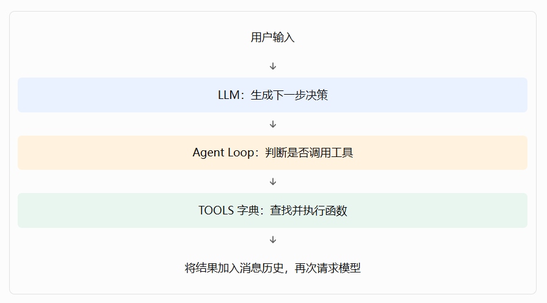
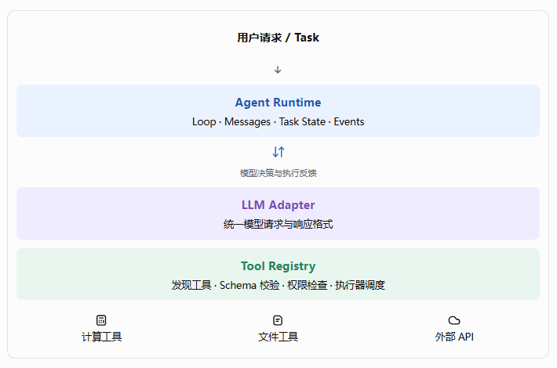
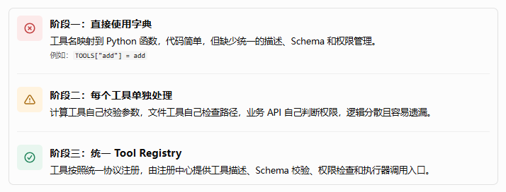

## 前言

在第四篇“亲手实现第一个 Agent”中，我们已经完成了从模型决策到工具执行的基本流程，理解了 Agent Loop 如何连接模型、工具和执行结果。

但如果继续开发企业级 Agent，很快就会遇到两个问题：

- 工具越来越多，怎么统一管理？ 如果每增加一个工具，都需要修改 Agent 主循环、手动编写参数校验和权限判断，系统会越来越难维护。
- Agent 的执行过程怎么统一管理？ 如果模型调用、工具执行、消息历史、任务状态和事件分别由不同的代码管理，就很难追踪任务进度、处理中断、定位错误，也难以扩展到长任务和多 Agent 协作。

因此，接下来我们不再从零重复实现一个 Agent，而是以第四篇的 First Agent 为基础，逐步将它升级为企业级 Agent 系统。

本篇 Tool Registry——工具注册中心：

> 统一管理工具的名称、描述、参数 Schema、权限要求和执行器，让 Agent 能够发现、校验并安全调用工具。

## 一、先明确：我们要把 First Agent 改造成什么？

第四篇的最小 Agent 可以简化为以下结构：



这种方式足以验证 Agent 的基本原理，但工具一多，就会出现明显的问题。

例如，最初只有一个 `add()` 计算工具：

```python
TOOLS = {
    "add": add,
}
```

后来需要增加天气查询、文件读写、数据库查询、网页搜索和业务 API。假如每个工具都要在 Agent Loop 中增加专门的分支，核心执行代码就会逐渐变成一个庞大的条件判断集合。

同样，如果任务状态只保存在一个局部变量里，那么当任务执行到一半时，系统就难以统一记录它已经完成了哪些步骤。

我们的目标是将架构演进为：



这里要先区分两个概念：

- Tool Registry 是工具的管理与调度入口，负责描述工具、查找工具、校验参数、检查权限，并把调用交给对应的执行器。
- Agent Runtime 是 Agent 的统一执行环境，负责组织模型调用、工具执行、消息更新、任务状态变化和事件输出。

二者相互配合，但职责不同。Runtime 不应该知道每个工具内部如何实现；工具也不应该自行控制整个 Agent Loop。

## 二、第一步：设计工具注册中心 Tool Registry

### 2.1 为什么需要统一的工具注册中心？

先看一个常见的设计演进过程。



阶段一：直接使用字典

工具名映射到 Python 函数，代码简单，但缺少统一的描述、Schema 和权限管理。

例如：`TOOLS["add"] = add`

阶段二：每个工具单独处理

计算工具自己校验参数，文件工具自己检查路径，业务 API 自己判断权限，逻辑分散且容易遗漏。

阶段三：统一 Tool Registry

工具按照统一协议注册，由注册中心提供工具描述、Schema 校验、权限检查和执行器调用入口。

工具注册中心的核心价值，不是简单地把字典换成一个类，而是建立统一的工具契约（Tool Contract）。

### 2.2 一个工具应该包含哪些信息？

我们先定义一个标准工具对象。

| 字段                   | 作用             | 示例                 |
| ---------------------- | ---------------- | -------------------- |
| `name`                 | 工具唯一名称     | `calculator.add`     |
| `description`          | 工具用途         | 计算两个数字的和     |
| `parameters`           | 参数 JSON Schema | `a`、`b` 均为数字    |
| `required_permissions` | 所需权限         | `calculator:execute` |
| `executor`             | 实际执行函数     | `add`                |
| `timeout_seconds`      | 执行超时配置     | 5 秒                 |
| `enabled`              | 是否允许调用     | `True`               |

这里有一个重要的设计原则：

工具的描述信息与工具的执行实现应当分离。

LLM 只需要看到工具名称、描述和参数 Schema；Runtime 则通过注册中心获取对应的执行器。这样既可以把 Python 函数包装成工具，也可以在后续把 HTTP API、数据库查询和 MCP 工具统一接入。

### 2.3 定义 Tool、ToolContext 和 ToolResult

创建项目目录：

```
agent-enterprise/
├── app/
│   ├── __init__.py
│   ├── tool_registry.py
│   ├── runtime.py
│   ├── models.py
│   └── main.py
└── tests/
    ├── test_tool_registry.py
    └── test_runtime.py
```

本篇先使用 Python 3.11+ 的标准库实现最小版本，不依赖某个 Agent 框架。这样更容易理解每个组件的职责。后续可以再接入真实 LLM SDK 和数据库。

首先创建 `app/tool_registry.py`：

```python
from dataclasses import dataclass, field
from typing import Any, Callable


ToolExecutor = Callable[..., Any]


@dataclass
class ToolContext:
    task_id: str
    user_id: str
    permissions: set[str] = field(default_factory=set)


@dataclass
class ToolResult:
    success: bool
    data: Any = None
    error: str | None = None


@dataclass
class ToolDefinition:
    name: str
    description: str
    parameters: dict[str, Any]
    required_permissions: set[str]
    executor: ToolExecutor
    timeout_seconds: float = 5.0
    enabled: bool = True
```

逐个理解这些类型。

- `ToolDefinition` 是工具的定义，保存工具元数据和执行器。
- `ToolContext` 是本次调用的执行上下文，提供任务、用户和权限信息。
- `ToolResult` 是统一的执行结果，成功时返回 `data`，失败时返回 `error`。

为什么要有 `ToolContext`？

因为工具执行可能与当前用户、租户、任务和权限有关。例如，同一个文件读取工具，用户 A 可以读取自己的工作区文件，但不应该因此获得读取用户 B 文件的权限。

为什么要统一 `ToolResult`？

因为工具的内部实现可能各不相同，但 Runtime 不应该为了处理计算结果、文件结果、API 响应而写一堆不同的判断分支。

### 2.4 为工具增加 JSON Schema 参数校验

假设 LLM 请求：

```json
{
  "tool": "calculator.add",
  "arguments": {
    "a": 12,
    "b": 30
  }
}
```

注册中心需要验证：

1. 工具是否存在且已启用。
2. 参数是否符合 Schema。
3. 是否存在多余参数。
4. 参数类型和值是否符合约束。

在本篇中，我们先实现一个覆盖常见参数类型的轻量 Schema 校验器。它支持 `object`、`string`、`integer`、`number`、`boolean`、`array` 和 `required` 等基本规则。它不是完整的 JSON Schema 实现；生产环境可以使用 `jsonschema` 等标准库外依赖来支持完整规范。

继续在 `tool_registry.py` 中添加：

```python
def validate_schema(
    value: Any,
    schema: dict[str, Any],
    path: str = "$",
) -> None:
    expected = schema.get("type")

    type_checks = {
        "object": lambda v: isinstance(v, dict),
        "array": lambda v: isinstance(v, list),
        "string": lambda v: isinstance(v, str),
        # bool 是 int 的子类，必须单独排除
        "integer": lambda v: (
            isinstance(v, int) and not isinstance(v, bool)
        ),
        "number": lambda v: (
            isinstance(v, (int, float))
            and not isinstance(v, bool)
        ),
        "boolean": lambda v: isinstance(v, bool),
    }

    if expected in type_checks and not type_checks[expected](value):
        raise ValueError(
            f"{path}: expected {expected}"
        )

    if expected == "object":
        properties = schema.get("properties", {})
        required = schema.get("required", [])

        missing = set(required) - value.keys()
        if missing:
            raise ValueError(
                f"{path}: missing fields {sorted(missing)}"
            )

        if schema.get("additionalProperties") is False:
            extra = value.keys() - properties.keys()
            if extra:
                raise ValueError(
                    f"{path}: unexpected fields {sorted(extra)}"
                )

        for key, item in value.items():
            if key in properties:
                validate_schema(
                    item,
                    properties[key],
                    f"{path}.{key}",
                )

    if expected == "array":
        for index, item in enumerate(value):
            validate_schema(
                item,
                schema.get("items", {}),
                f"{path}[{index}]",
            )

    if expected in ("integer", "number"):
        if "minimum" in schema and value < schema["minimum"]:
            raise ValueError(f"{path}: value below minimum")

        if "maximum" in schema and value > schema["maximum"]:
            raise ValueError(f"{path}: value above maximum")

    if "enum" in schema and value not in schema["enum"]:
        raise ValueError(f"{path}: value not in enum")
```

这个实现有意保持精简。它没有完整处理 `oneOf`、`anyOf`、复杂组合 Schema、字符串格式和全部数值约束，因此不要将其直接当成完整的生产级 JSON Schema 校验器。

还有一个容易忽略的细节：Python 中 `isinstance(True, int)` 的结果是 `True`。如果不单独排除布尔值，某些本应只接受整数的工具可能会错误地接受 `True`。

### 2.5 实现 ToolRegistry

接下来，创建工具注册中心本身。

继续添加到 `app/tool_registry.py`：

```python
class ToolRegistry:
    def __init__(self) -> None:
        self._tools: dict[str, ToolDefinition] = {}

    def register(self, tool: ToolDefinition) -> None:
        if tool.name in self._tools:
            raise ValueError(f"工具已注册: {tool.name}")

        if tool.timeout_seconds <= 0:
            raise ValueError("timeout_seconds 必须大于 0")

        self._tools[tool.name] = tool

    def get(self, name: str) -> ToolDefinition:
        tool = self._tools.get(name)

        if tool is None or not tool.enabled:
            raise ValueError(f"工具不存在或已禁用: {name}")

        return tool

    def list_tools(self) -> list[dict[str, Any]]:
        return [
            {
                "name": tool.name,
                "description": tool.description,
                "parameters": tool.parameters,
            }
            for tool in self._tools.values()
            if tool.enabled
        ]

    def invoke(
        self,
        name: str,
        arguments: dict[str, Any],
        context: ToolContext,
    ) -> ToolResult:
        try:
            tool = self.get(name)

            validate_schema(arguments, tool.parameters)

            missing_permissions = (
                tool.required_permissions - context.permissions
            )
            if missing_permissions:
                raise PermissionError(
                    f"缺少权限: {sorted(missing_permissions)}"
                )

            result = tool.executor(
                **arguments,
            )
            return ToolResult(success=True, data=result)

        except Exception as exc:
            return ToolResult(
                success=False,
                error=f"{type(exc).__name__}: {exc}",
            )
```

现在，我们已经具备了一个最小工具注册中心。

不过，需要特别指出：上面的 `invoke()` 还没有真正实现超时执行。虽然工具定义中已经有 `timeout_seconds`，但它目前只是配置字段。下一节会在执行边界上补齐超时控制。

此外，`ToolContext` 只用于传递调用上下文，不能替代真正的身份认证和授权。实际的用户身份应由可信的应用后端生成，而不是接受模型自行提供的 `user_id` 或权限集合。

### 2.6 注册第一个计算工具

新建 `app/main.py`，先实现两个工具：加法与乘法。

```python
from typing import Any

from app.tool_registry import (
    ToolContext,
    ToolDefinition,
    ToolRegistry,
)


def add(a: int, b: int) -> int:
    return a + b


def multiply(a: int, b: int) -> int:
    return a * b


registry = ToolRegistry()

registry.register(
    ToolDefinition(
        name="calculator.add",
        description="计算两个数字的和",
        parameters={
            "type": "object",
            "properties": {
                "a": {"type": "integer"},
                "b": {"type": "integer"},
            },
            "required": ["a", "b"],
            "additionalProperties": False,
        },
        required_permissions={"calculator:execute"},
        executor=add,
    )
)

registry.register(
    ToolDefinition(
        name="calculator.multiply",
        description="计算两个数字的乘积",
        parameters={
            "type": "object",
            "properties": {
                "a": {"type": "integer"},
                "b": {"type": "integer"},
            },
            "required": ["a", "b"],
            "additionalProperties": False,
        },
        required_permissions={"calculator:execute"},
        executor=multiply,
    )
)


if __name__ == "__main__":
    context = ToolContext(
        task_id="task-001",
        user_id="user-001",
        permissions={"calculator:execute"},
    )

    print(registry.list_tools())

    result = registry.invoke(
        "calculator.add",
        {"a": 12, "b": 30},
        context,
    )

    print(result)
```

运行：

```
python -m app.main
```

成功时，调用结果的核心内容应为：

```
ToolResult(success=True, data=42, error=None)
```

至此，工具不再只是一个函数，而是具有明确描述、参数契约、权限要求和执行入口的标准化能力。

### 2.7 补齐执行超时：让工具调用更可靠

企业级工具不能无限执行。一个 HTTP API 可能一直没有响应，一个数据库查询也可能耗时过长。

我们可以为注册中心增加一个统一的异步执行入口。将 `ToolRegistry` 中的 `invoke()` 保留为同步底层接口，再增加：

```python
import asyncio


class ToolRegistry(ToolRegistry):
    async def invoke_async(
        self,
        name: str,
        arguments: dict[str, Any],
        context: ToolContext,
    ) -> ToolResult:
        try:
            tool = self.get(name)

            return await asyncio.wait_for(
                asyncio.to_thread(
                    self._invoke_checked,
                    tool,
                    arguments,
                    context,
                ),
                timeout=tool.timeout_seconds,
            )
        except asyncio.TimeoutError:
            return ToolResult(
                success=False,
                error=f"工具执行超时: {name}",
            )
        except Exception as exc:
            return ToolResult(
                success=False,
                error=f"{type(exc).__name__}: {exc}",
            )

    def _invoke_checked(
        self,
        tool: ToolDefinition,
        arguments: dict[str, Any],
        context: ToolContext,
    ) -> ToolResult:
        # 在真正执行前再次校验参数与权限
        validate_schema(arguments, tool.parameters)

        missing = (
            tool.required_permissions - context.permissions
        )
        if missing:
            raise PermissionError(
                f"缺少权限: {sorted(missing)}"
            )

        return ToolResult(
            success=True,
            data=tool.executor(**arguments),
        )
```

这段代码展示了超时控制的基本思路，但要注意两点：

1. 上述代码中的 `class ToolRegistry(ToolRegistry)` 是为了展示新增方法，实际项目中应把 `invoke_async()` 和 `_invoke_checked()` 合并进原来的 `ToolRegistry` 类，而不是保留两个同名类定义。
2. `asyncio.wait_for()` 超时后，不保证底层线程中的同步函数已经停止。对于可能修改数据、调用外部 API 或执行不可信代码的工具，生产系统还需要支持真正的取消机制、隔离执行和幂等控制。

在完成这个模块后，我们已经具备了工具注册、查询、Schema 校验、权限检查、统一结果和基础超时控制的设计基础。

## 三、第二步：让工具注册中心真正服务于 LLM

上一节已经实现了工具的管理与执行，但还有一个问题：

模型如何知道当前有哪些工具可以调用？

如果我们只在 Python 代码中注册工具，却不将工具描述提供给模型，模型就无法依据工具的名称、用途和参数定义来生成正确的调用请求。

### 3.1 区分内部工具定义与模型工具 Schema

内部工具定义包含执行器和权限等信息，而模型通常只需要看到公开的工具描述。

例如，注册中心可以将工具转换成如下格式：

```json
{
  "name": "calculator.add",
  "description": "计算两个数字的和",
  "parameters": {
    "type": "object",
    "properties": {
      "a": {"type": "integer"},
      "b": {"type": "integer"}
    },
    "required": ["a", "b"],
    "additionalProperties": false
  }
}
```

其中不应该向模型暴露：

- Python 函数对象。
- 内部密钥和连接字符串。
- 用户的完整权限列表。
- 内部服务器地址等不必要的敏感信息。

我们可以直接使用前面实现的 `list_tools()` 作为模型工具描述的来源。真实模型 API 的字段格式可能不同，因此还需要一个模型适配层，将内部格式转换为相应 SDK 所要求的结构。

### 3.2 定义统一的模型决策协议

为了避免 Runtime 绑定某个具体模型厂商，我们规定模型适配器统一返回两类决策：

```python
from dataclasses import dataclass
from typing import Any


@dataclass
class ToolCall:
    id: str
    name: str
    arguments: dict[str, Any]


@dataclass
class ModelDecision:
    type: str  # "tool_call" 或 "final"
    content: str = ""
    tool_calls: list[ToolCall] | None = None
```

这个内部协议的作用，是把不同模型 API 的返回格式统一起来。

例如，某个模型返回原生的 `tool_calls`，另一个模型可能返回不同的函数调用结构。适配器负责将它们转换为 `ModelDecision`，Runtime 只处理统一协议。

这样一来，替换模型供应商时，就不必重写整个 Agent 执行循环。

下面就是开始设计统一的 Agent Runtime。